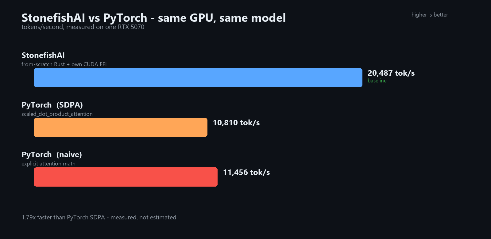
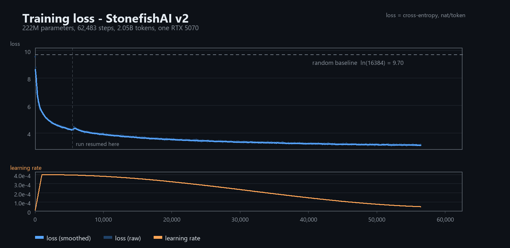
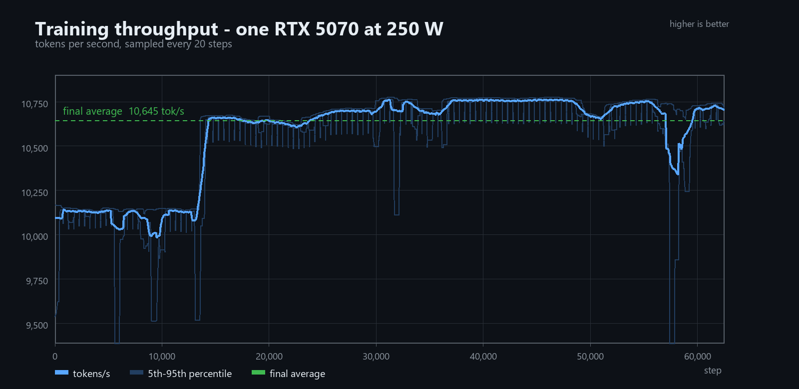

# 🐟 StonefishAI

**A from-scratch autograd engine and language-model stack in Rust — ZERO dependencies.**

```console
$ cargo tree
stonefish_ai v1.0.0
```

Everything from `Tensor` and topological backprop to optimizers and CUDA kernels is written by hand in this repository. **`[dependencies]` is empty.** The CUDA driver, cuBLAS and NVRTC are loaded dynamically at runtime (`LoadLibraryW` / `dlopen`) — not even `cudarc`, only the operating system's library loader.

On machines without CUDA, `--no-default-features` runs everything on the CPU.

> Turkish version: [README-Tr.md](README-Tr.md)

> **Status:** v1 released and measured (val loss 2.3700 · BPC 0.6913). v2 (222M parameters, 2.05B tokens, new architecture) is training - ETA 19 Nov 2026.

---

## Contents

1. [What it can / cannot do](#1-what-it-can--cannot-do)
2. [Quick start](#2-quick-start)
3. [Hardware and measured limits](#3-hardware-and-measured-limits)
4. [Architecture](#4-architecture)
5. [Design decisions](#5-design-decisions)
6. [The two model pipelines](#6-the-two-model-pipelines)
7. [Measured results](#7-measured-results)
8. [Time-budget profile](#8-time-budget-profile)
9. [Tests](#9-tests)
10. [Bugs found during development](#10-bugs-found-during-development)
11. [Known limitations](#11-known-limitations)
12. [Roadmap — what comes next](#12-roadmap--what-comes-next)
13. [Directory layout](#13-directory-layout)
14. [How zero dependencies works](#14-how-zero-dependencies-works)
15. [**Timeline — from 15 June to today**](#15-timeline--from-15-june-to-today)

---

## 1. What it can / cannot do

### ✅ What it can do

| Capability | Measure |
|---|---|
| Handwritten digit classification (MNIST) | **98.12 %** test accuracy |
| Turkish character-level text generation | val CE **1.6230** (random baseline 4.91) |
| English BPE-16k language-model training | 236 M params, 450 M tokens, ~10,000 tok/s |
| Gradient verification | 29 ops checked by central differences |
| GPU training | device-resident, 244,698 tok/s (small model) |
| Checkpoint management | config+vocab embedded, errors instead of panics, resumable |

### ❌ What it cannot do (honest list)

- **It is not a chat assistant.** No instruction following, Q&A, translation, summarization, or code generation.
- **No world knowledge.** It cannot answer "What is the capital of France?"
- **No reasoning.** No arithmetic, logic chains, or multi-step inference.
- **No meaning.** Generated text is grammatical but semantically empty; the model produces statistical continuations.
- **The Turkish model is 842 K params**, the English one 236 M — both in the "undertrained" class (~8.6 M and ~450 M tokens respectively).
- **No KV-cache** → generation is O(n²); 300 tokens ≈ 2.8 s.
- **The English model is not yet validated** — `en-eval` measurement comes after training finishes.

---

## 2. Quick start

```bash
# Build (on a machine without CUDA: --no-default-features)
cargo build --release

# List all modes
./target/release/stonefish_ai help

# ⚡ ONE-COMMAND DEMO — no downloads, trains from scratch in 90 s and generates text
./target/release/stonefish_ai demo 90

# --- MNIST MLP ---
./target/release/stonefish_ai train          # train (20 epochs)
./target/release/stonefish_ai eval           # measure on test set → 98.12 %

# --- Turkish GPT (character level) ---
./target/release/stonefish_ai gpt-train 6 8                        # epochs, batch
./target/release/stonefish_ai gpt-gen "evening falls early" 300 0.8   # prompt, tokens, temperature

# --- English GPT (BPE-16k, 236 M) ---
./target/release/stonefish_ai en-prepare           # learn BPE + build u16 cache
./target/release/stonefish_ai en-train 450000000   # token budget

# --- Measurement ---
./target/release/stonefish_ai test-gpt-profile   # where does the time go
./target/release/stonefish_ai test-gpu-native    # GPU-native trainer speed
./target/release/stonefish_ai test-matmul-bench  # CPU vs GPU at real shapes
./target/release/stonefish_ai test-gpu-bench-big
```

### Data requirements

| File | What | Where |
|---|---|---|
| `data/train-images-idx3-ubyte` + 3 siblings | MNIST | [yann.lecun.com/exdb/mnist](http://yann.lecun.com/exdb/mnist/) |
| `data/turkish.txt` | Turkish corpus (plain text) | your own text |
| `data/en/train.txt` | English corpus | TinyStories v2 (~2.1 GB) |
| `data/en/valid.txt` | English validation | TinyStories valid (~18 MB) |

`data/`, `*.bin`, `*.state`, `*.bpe` are **not committed** (`.gitignore`).

Downloading TinyStories:
```powershell
$b = "https://huggingface.co/datasets/roneneldan/TinyStories/resolve/main"
Invoke-WebRequest "$b/TinyStoriesV2-GPT4-train.txt" -OutFile data/en/train.txt
Invoke-WebRequest "$b/TinyStories-valid.txt"        -OutFile data/en/valid.txt
```

---

## 3. Hardware and measured limits

Development/test environment: **RTX 5070 (12 GB), 32 GB DDR5, MSI Trident AS (≈10 L SFF)**, Windows.

| Limit | Value | Consequence |
|---|---|---|
| VRAM | 12 GB | with the fp32 trainer, **~250 M parameters** is the ceiling |
| RAM | 32 GB | 3 B tokens would **not fit** without the streaming pipeline (u16 + disk cache solves it) |
| Thermals | SFF chassis | 80 °C at 250 W → **210 W power limit** applied, dropped to 76 °C |
| Time | single GPU | 236 M model + 450 M tokens ≈ **12.5 hours** |

Measured training throughput:

| Model | Step time | Throughput |
|---|---|---|
| 842 K (GPU-native) | 4.2 ms | **244,698 tok/s** |
| 842 K (CPU + cuBLAS) | 120.8 ms | 8,476 tok/s |
| **236 M (GPU-native)** | ~3.27 s | **~10,000 tok/s** |

---

## 4. Architecture

| File | Lines | Responsibility |
|---|---|---|
| [src/lib.rs](src/lib.rs) | 35 | Library root, `VERSION`, justified clippy allows |
| [src/sys/mod.rs](src/sys/mod.rs) | 190 | Dynamic library loader (LoadLibraryW / dlopen) |
| [src/sys/cuda.rs](src/sys/cuda.rs) | 200 | CUDA driver API (memory, context, module, kernel) |
| [src/sys/cublas.rs](src/sys/cublas.rs) | 80 | cuBLAS SGEMM + strided-batched |
| [src/sys/nvrtc.rs](src/sys/nvrtc.rs) | 130 | NVRTC — runtime CUDA C compilation |
| [src/sys/dev.rs](src/sys/dev.rs) | 520 | `DevBuf`/views, module, kernel launch |
| [src/sys/selftest.rs](src/sys/selftest.rs) | 250 | FFI self-test (`test-ffi` mode) |
| [src/tensor.rs](src/tensor.rs) | 142 | `Matrix` (row-major 2D): matmul, transpose, broadcast add/sub |
| [src/autograd.rs](src/autograd.rs) | 845 | `Tensor`, `Op` (17 variants), topological backward, all ops |
| [src/nn.rs](src/nn.rs) | 99 | `Linear`, MNIST model (de)serialization |
| [src/transformer.rs](src/transformer.rs) | 246 | Embedding, MultiHeadSelfAttention, TransformerBlock, GPT, GptConfig |
| [src/checkpoint.rs](src/checkpoint.rs) | 147 | GPT checkpoint v2 (magic/version/config/vocab/tensors) |
| [src/optim.rs](src/optim.rs) | 167 | SGD, Adam (with bias correction), `clip_grad_norm` |
| [src/loss.rs](src/loss.rs) | 7 | Softmax + cross-entropy |
| [src/data.rs](src/data.rs) | 79 | MNIST idx reader, text → sequences |
| [src/tokenizer.rs](src/tokenizer.rs) | 128 | Character-level tokenizer |
| [src/bpe.rs](src/bpe.rs) | 236 | Byte-level BPE: merge learning + encode/decode |
| [src/corpus.rs](src/corpus.rs) | 251 | u16 token cache, windowed streaming reader |
| [src/gpu.rs](src/gpu.rs) | 362 | cuBLAS GEMM (plain/transposed/device/strided-batched) + CPU fallback |
| [src/gpu_kernels.rs](src/gpu_kernels.rs) | 405 | NVRTC compilation + PTX cache + 15 kernel wrappers |
| [src/gpu_train.rs](src/gpu_train.rs) | 1289 | Device-resident GPT trainer (fast path) |
| [src/en_train.rs](src/en_train.rs) | 270 | English pipeline: `prepare` + `train` |
| [src/profile.rs](src/profile.rs) | 119 | Lightweight profiling counters |
| [src/main.rs](src/main.rs) | 1252 | CLI (20 modes) + training loops + `Trainer` abstraction |
| [kernels/stonefish.cu](kernels/stonefish.cu) | 389 | CUDA kernels |

Total: **~6,300 lines of Rust** + 389 lines of CUDA.

---

## 5. Design decisions

### 5.1 Batching by row packing (no Tensor3D)

A `(batch, seq, d_model)` tensor is stored as a **`(batch·seq, d_model)` matrix**:

```
(B, S, D) ──pack──▶ (B·S, D)
```

LayerNorm, Linear, GELU, bias-add and softmax are already **row-wise**, so this transformation is free. The only exception is attention, handled inside `Op::CausalAttention` with `batch`/`seq`/`n_heads` metadata.

**Result:** one engine instead of two parallel APIs, real batch gradients, a single `backward()` call. The old `Tensor3D` type was removed entirely.

### 5.2 Fused causal multi-head attention

`Tensor::causal_attention(q, k, v, batch, seq, n_heads)` is **a single node**:

- splits `d_model` into `n_heads` slices (`d_head = d_model/n_heads`)
- `1/√d_head` scaling
- causal mask
- per-head softmax
- **the backward for all of it**

Attention weights are cached as `(batch·n_heads·seq, seq)`; dQ/dK/dV are produced in one pass. Because scaling and masking live *inside* the op, they cannot be mis-composed outside.

### 5.3 Row-major GEMM → cuBLAS (transpose trick)

cuBLAS is column-major. For row-major `C(m,n) = A·B`:

```
Cᵀ = Bᵀ · Aᵀ   →  operands swap, expressed via transa/transb
```

`dev_gemm_batched` performs this mapping for `Nn/Nt/Tn`; `lda` = **B's row stride**, `ldb` = **A's row stride**, `ldc` = C's row stride. Transposes are therefore **never materialized** (the old code took a `(1024×128)` strided copy on every backward).

### 5.4 CUDA kernels: NVRTC instead of nvcc

This machine has no host C++ compiler (`cl.exe`), so `nvcc` fails. **NVRTC** only compiles device code, so it works:

- runtime compilation (~100-300 ms, once)
- PTX cached under `target/gpu-cache/` (key: source + arch + version)
- arch read from the device (`compute_120` → RTX 5070)

### 5.5 Two trainers, one interface

| | CPU + cuBLAS | GPU-native |
|---|---|---|
| What | autograd graph | hand-written forward/backward |
| Where | `main.rs` + `autograd.rs` | `gpu_train.rs` |
| Role | **reference** (gradient tests) | tied to CPU via equivalence tests |
| Speed | 8,476 tok/s | **244,698 tok/s** |

`gpt-train` automatically selects the GPU path when CUDA is present, otherwise falls back to CPU.

### 5.6 Tokenizer: characters first, BPE later

A character-level model spends most of its capacity learning **spelling**. With byte-level BPE-16k the same window covers **4-5× more text** (measured: 4.7 characters/token).

BPE learning uses **incremental pair counting**: after each merge only words containing that pair are rescanned → 16k merges in **7 seconds** (the naive approach took hours).

### 5.7 Data pipeline: u16 + disk cache

`Vec<usize>` = 8 bytes per token → 3 B tokens would need **24 GB of RAM**. Instead:

- tokenized corpus is written to disk as **u16** (2 bytes/token)
- training reads through a 64 MB **memory window**; the whole file is never loaded
- tokenization: **148 MB/s** (word-cached)

---

## 6. The two model pipelines

### 6.1 Turkish (character level)

| | |
|---|---|
| Model | `d_model=128`, 4 layers, 4 heads (`d_head=32`), ctx=128 |
| Vocab | 136 characters |
| Parameters | **842,632** |
| Corpus | `data/turkish.txt` — 2,870,158 characters, 22,423 sequences |
| Checkpoint | `stonefish_gpt.bin` (v2: magic + config + vocab + tensors) |
| Training | 6 epochs, 16,620 steps, batch 8 |

Training curve (GPU-native, 70 seconds):

| Epoch | train CE | val CE |
|---|---|---|
| 0 | 2.1881 | 1.8943 |
| 1 | 1.7973 | 1.7624 |
| 2 | 1.6868 | 1.6939 |
| 3 | 1.6145 | 1.6538 |
| 4 | 1.5591 | 1.6309 |
| 5 | **1.5215** | **1.6230** |

Reproducibility: hyperparameters + seeds + per-epoch metrics are written to `runs/<ts>.json`.

### 6.2 English (BPE-16k) — **active development**

| | |
|---|---|
| Model | `d_model=1024`, 16 layers, 8 heads (`d_head=128`), ctx=512 |
| Vocab | **16,384** (byte-level BPE) |
| Parameters | **235,571,200** |
| Corpus | TinyStories v2: **450,873,533** train + 3,931,894 valid tokens |
| Compression | 4.7 characters/token |
| Batch | 4 × gradient accumulation 16 = effective 64 sequences (32,768 tokens/step) |
| Plan | 13,732 steps, max_lr=6e-4, 500-step warmup + cosine, clip=1.0 |
| VRAM | 8.4 GB / 12 GB |
| Speed | ~10,000 tok/s → **~12.5 hours** |
| Checkpoint | `stonefish_en.state` (`SFEN001`, every 500 steps) |

**Training completed (2026-11-17):** 13,732 steps, **745 minutes**, 10,061 tok/s average.

**Measured quality (`valid.bin`, 3,928,064 tokens):**

| Metric | Value |
|---|---|
| val loss | **2.3700** nats/token |
| perplexity | **10.70** |
| **BPC** | **0.6913 bits/character** |
| final train loss | ~1.95 (gap 0.42 → mild overfitting) |
| random baseline | 9.70 |

**Sample generation (temperature 0, greedy):**

> Once upon a time-out lived a little girl named Lily. She loved to play with her toys and make up stories. One day, she found a big box in her room. She was very excited and wanted to see what was inside.
> Lily opened the box and found a lot of fun toys inside. She played with the toys and had a lot of fun. But then, she heard a loud noise outside. She looked out the window and saw a big, scary monster! The monster was very big and scary. Lily was scared and ran back to her room.

**Dialogue formatting (temperature 0.8):**

> "Yes! I love to play with my car," Tommy said.
> "But I need your toy car," Jane said.

The model learned the `<|endoftext|>` story boundary and quoted dialogue formatting on its own.

---

## 7. Measured results

### 7.1 MNIST MLP (784→128→10)

SGD lr=0.01, batch 64, 20 epochs → **98.12 %** test accuracy (10,000 images, 196 errors).

### 7.2 GPU vs CPU matmul (RTX 5070, after warm-up)

| GEMM | CPU | GPU | Speed-up |
|---|---|---|---|
| `(1024×128)@(128×128)` attn proj | 1.119 ms | 0.189 ms | **5.9×** |
| `(1024×128)@(128×512)` ff1 | 5.697 ms | 0.975 ms | **5.8×** |
| `(1024×512)@(512×128)` ff2 | 5.310 ms | 0.284 ms | **18.7×** |
| `(1024×128)@(128×136)` lm head | 1.150 ms | 0.210 ms | **5.5×** |
| `(128×128)@(128×128)` inference (B=1) | 0.132 ms | 0.055 ms | **2.4×** |

1024³: CPU 2.16 s / GPU-only **67.5 µs** / transfer+matmul 2.23 ms.

### 7.3 End-to-end training (6 epochs, same model)

| Path | Step time | Throughput | 6 epochs |
|---|---|---|---|
| CPU + cuBLAS (autograd) | 120.1 ms | 8,476 tok/s | **54.4 min** |
| **GPU-native (device-resident)** | **4.2 ms** | **244,698 tok/s** | **70 s** |

**46.7× speed-up.** Val CE: CPU 1.6337 / GPU 1.6230 (fast-math + summation order).

### 7.4 English 236 M

~10,000 tok/s, 8.4 GB VRAM, 76 °C (at 250 W), GPU 99 % — throughput never dropped over 11 hours.
Loss curve: 9.70 (random) → **~1.97** (at 90 %, still falling).

### 7.5 Against PyTorch - same GPU, same architecture



`tools/torch_bench.py` rebuilds the v2 architecture (RMSNorm + SwiGLU + RoPE +
weight tying) exactly in PyTorch; same data, same batch, same GPU. All three
measurements were taken on the same machine after the same warm-up.

| Implementation | tok/s | Note |
|---|---|---|
| **StonefishAI** | **20,487** | from-scratch Rust + our own CUDA FFI |
| PyTorch (naive attention) | 11,456 | explicit `q @ k.T` |
| PyTorch (`F.scaled_dot_product_attention`) | 10,810 | PyTorch's fastest path |

The gap does not come from PyTorch's Python loop but from **memory traffic**:
our fused causal attention runs in a single kernel and never materialises the
B×S×S score matrix. (Measured at 35.7M parameters; the 222M run will be
repeated once training finishes.)

---

## 8. Time-budget profile

`test-gpt-profile` (842 K model, real config, 10-step average):

| Item | ms/step | share |
|---|---|---|
| attention fwd+bwd (CPU) | 35.3 | 29.5 % |
| matmul **transfer** (CPU↔GPU) | 21.1 | 17.6 % |
| matmul **real GEMM** | **1.0** | **0.8 %** |
| GELU fwd+bwd | 17.7 | 14.8 % |
| LayerNorm fwd+bwd | 7.4 | 6.1 % |
| intermediate tensor allocation | 6.0 | 5.0 % |
| adam.step / CE / zero_grad | 3.4 | 2.9 % |
| other (alloc, packing, residuals) | ~27 | ~23 % |
| **total** | **~120** | 100 % |

**Key insight:** a step issues 75 matmul calls but the real GEMM total is 1 ms. So "keep GEMMs on the GPU" (eliminating transfers) buys at most 17 %; the real win comes from **moving the computation itself to the GPU**. The GPU-native path does exactly that and yields 46.7×.

---

## 9. Tests

**62 tests** (with CUDA), **48 tests** (CPU-only) — all green, **0 clippy warnings**:

| Group | Count | What it verifies |
|---|---|---|
| [tests/gradcheck.rs](tests/gradcheck.rs) | 29 | Every op: analytic vs numeric gradient by **central differences** |
| [tests/gpu_kernels.rs](tests/gpu_kernels.rs) | 12 | 15 CUDA kernels + device GEMM modes against CPU reference |
| [tests/gpu_train_equiv.rs](tests/gpu_train_equiv.rs) | 2 | GPU trainer ↔ CPU autograd: **all gradients** + 5-step Adam loss curve |
| [tests/checkpoint.rs](tests/checkpoint.rs) | 5 | Roundtrip, bad magic, truncated file, vocab mismatch, drift |
| Unit tests | 14 | Tokenizer (4), optimizer/clip (4), BPE (4), corpus (2) |

Gradient coverage: `add`/`sub` (incl. broadcast), `mul_elem`, `matmul` (incl. square), `matmul+transpose`, `scale`, `relu`, `sigmoid`, `transpose`, `sum`, `softmax_ce`, `softmax_ce_ids` (sparse), `softmax`, `mask_causal`, `gelu`, `layer_norm`, `embedding`, `causal_attention` (single/multi-head + batched), end-to-end tiny GPT, causality contract, batch gradient = Σ per-sequence gradients.

```bash
cargo test --release                       # CUDA path
cargo test --release --no-default-features  # CPU path
```

---

## 10. Bugs found during development

This list is the most valuable part of the project: **every one was caught by a test.**

| # | Bug | How it was found |
|---|---|---|
| 1 | `mask_causal` test: `-1e9` mask pushed the loss to ~1e9; `f32` ulp(1e9)≈64 swallowed `ΔL≈1e-3` | Gradient test (the *test* was wrong) |
| 2 | `eps` calibration in gradcheck: embedding init 0.02 + LayerNorm → `eps=1e-3` is 10 % of a row, breaking linearity | Parameter-wise measurement with `grad_probe` |
| 3 | Wrong factor in the batch-gradient identity (B³) | Derived `L_batch = (1/B)·ΣL_b` and fixed |
| 4 | Attention backward used `q` instead of `dOut` for `dW` | 3 gradient tests turned red after vectorization |
| 5 | **Head stride**: score-buffer offset assumed `h·S²`, correct is `h·B·S²` | Scores came out zero → softmax 0.5/0.5 |
| 6 | **Residual gradient**: attention branch upstream is `dOut + dx_ln2`, not `dOut` (`res1 = x + proj`) | dAttn/dWo were wrong from the start |
| 7 | `dev_gemm` passed `beta=1.0` instead of `0.0` → results accumulated | GEMM mode test |
| 8 | BPE encode processed the whole 64 MB chunk at once (full vector scan per merge → O(n²)) | Tokenization appeared to hang; fixed with a word cache |
| 9 | Two processes writing the same output file ("Access denied") | A killed job's child process survived |
| 10 | An **orphan training process** started at 13:33 would have overwritten the checkpoint in the old (v1) format | Process inventory |
| 11 | `cargo clippy --fix` rewrote all of `data.rs` due to line endings | Reverted; `.gitattributes` (LF) added |

---

## 11. Known limitations

- **No KV-cache** — generation recomputes the whole context per token (O(n²)).
- **Position drift in generation** — as the window slides, `pos_emb` restarts from 0, so positions do not match training (RoPE fixes this).
- **fp32 training only** — no bf16; this caps VRAM usage at ~250 M parameters.
- **No gradient checkpointing** — activations are kept; needed for larger models.
- **Single-threaded CPU path** — no `rayon`; the CPU path is the reference/fallback.
- **Turkish model processed 17 M tokens** but the corpus is only 2.87 M (3.4 unique tokens/param) → limited diversity, heavy epoch repetition.
- **English model saw 450 M tokens** (1.9 tokens/param) → 1/10 of Chinchilla, i.e. **undertrained**.
- **No SFT/DPO** → the model shows no assistant behaviour.
- **No validation/generation tooling for the English path yet** (`en-eval`, `en-gen` are on the roadmap).
- No weight tying, dropout, RoPE, SwiGLU, or RMSNorm.

---

## 12. Roadmap — what comes next

### Phase A — Validate the English model *(on completion, ~1 hour)*

- [ ] **A1 `en-eval`**: val loss, **perplexity**, **BPC** over `valid.bin` (3.9 M tokens)
  - BPC = loss[token] / (ln2 × chars/token) → the only tokenizer-independent metric
  - Expected band after 450 M tokens: `loss 1.7–2.0`
- [ ] **A2 `en-gen`**: BPE encode → sliding-window forward → temperature/top-k → decode
- [ ] **A3 sample report**: raw generations (temperature 0 and 0.8)

### Phase B — Grow the data *(highest payoff)*

- [ ] **B1** Download and clean Project Gutenberg (~3-5 B tokens; strip headers/footers)
- [ ] **B2** Mix: 60 % TinyStories + 40 % Gutenberg → 2-4 B tokens
- [ ] **B3** Re-tokenize → ~6-8 GB u16 cache
- [ ] **B4** Retrain the same architecture on 2-4 B tokens (~2-3 days)
  - Target: 8-16 tokens/parameter → clear quality jump

### Phase C — Architectural improvements

- [ ] **C1 KV-cache**: 10-50× faster generation (O(n²) → O(n))
- [ ] **C2 RoPE**: rotary positions instead of learned absolute ones → long context, no position drift
- [ ] **C3 RMSNorm** (instead of LayerNorm), **SwiGLU** (FFN), **weight tying** (embed ↔ head), **dropout**
- [ ] **C4 bf16 mixed precision**: 2-3× speed + larger models (`__half` support in kernels)
- [ ] **C5 Memory-efficient/fused attention** (flash-attention style)
- [ ] **C6 Gradient checkpointing**: recompute activations → room for 300-500 M models

### Phase D — Scale

- [ ] **D1** Try 300 M (d=1024, L=20), measuring VRAM
- [ ] **D2** ctx 1024 (currently 512)

### Phase E — Alignment (assistant behaviour)

- [ ] **E1** SFT dataset: 10-50 k `(instruction, response)` pairs *(the hard part)*
- [ ] **E2** Chat template (`<|user|>… <|assistant|>…`) + SFT fine-tuning
- [ ] **E3** DPO / preference training (style, helpfulness, refusal)
- [ ] **E4** Instruction-following evaluation set

### Phase F — Engineering debt

- [ ] **F1** Checkpoint **v3**: embed the BPE merge table (currently a separate `SFEN001` file)
- [ ] **F2** Automated tests for `en-eval`/`en-gen`
- [ ] **F3** Periodic checkpointing for the Turkish path too
- [ ] **F4** Keep both READMEs updated as Phases A-E progress

### Expectation table

| After phase | What you get |
|---|---|
| A | Measured quality + first real English samples |
| B | Fluent, topic-coherent, 2-3 paragraphs |
| C | ~2× speed on the same hardware, long context, less VRAM |
| D | Quality ceiling (hardware limit) |
| E | A model that **answers questions** (no knowledge, but the format) |

> **Honest caveat:** with a single RTX 5070 the reachable end point is ~250-300 M parameters and ~4 B tokens. That means "an impressive from-scratch engine + a real language model" — not "a usable assistant". A real assistant needs 1 B+ parameters and ~20 B tokens → cloud GPUs (8×A100, ~2 days, ~$700) or fine-tuning an existing base model.

---

## 13. Directory layout

```
StonefishAI/
├── Cargo.toml            # version 0.7.0, cuda feature (on by default)
├── README-Tr.md          # Turkish
├── README-Eng.md         # this file
├── kernels/
│   └── stonefish.cu      # 15 CUDA kernels (compiled via NVRTC)
├── src/                  # 18 modules (~6,300 lines)
├── tests/                # 4 files, 62 tests
├── examples/
│   ├── bpe_bench.rs      # BPE tokenization speed benchmark
│   └── grad_probe.rs     # parameter-wise gradient diagnostics
├── data/                 # (untracked) MNIST + corpora
└── runs/                 # (untracked) training manifests
```

**Engine principles:** written from scratch · gradients numerically verified · decisions driven by measurement · every bug locked down by a test · runs without CUDA.

---

## 14. How zero dependencies works

`[dependencies]` is empty. GPU access is entirely through our own FFI layer:

```
src/sys/mod.rs    LoadLibraryW (Windows) / dlopen (Linux) + GetProcAddress
                  → function pointers resolved lazily (OnceLock)
src/sys/cuda.rs   cuInit, cuCtxCreate, cuMemAlloc/HtoD/DtoH/Memset,
                  cuModuleLoadData, cuModuleGetFunction, cuLaunchKernel
src/sys/cublas.rs cublasCreate, cublasSetStream, cublasSgemm,
                  cublasSgemmStridedBatched
src/sys/nvrtc.rs  nvrtcCreateProgram, nvrtcCompileProgram, nvrtcGetPTX
```

**Why it matters:**

1. **No CUDA SDK at build time** — no import `.lib`, no `build.rs`
2. **Graceful degradation** — `LoadLibraryW` returns `None`, everything runs on CPU
3. **Auditable** — 1,100 lines of FFI instead of a 400-line crate's abstractions over the same API
4. **Verified** — `stonefish_ai test-ffi` checks alloc + copy + PTX load + kernel launch + cuBLAS SGEMM against CPU references (measured diff: **0.0**)

Kernel arguments are prepared by `Kargs`: each argument is written into one `u64` slot (device pointer = 8 bytes, i32/f32 = low 4 bytes) and `cuLaunchKernel` receives the addresses of those slots — zero allocation, zero copy.

---

## 15. Timeline — from 15 June to today

The project started on **15 June 2026**. The table below lists every step since then, in order, with its measurements.

> **Source note:** 15 June – 15 November was not under version control; that period was reconstructed from the development log and its run output. From 16 November onwards every step has a commit, a measurement and a test.

### 15 June – 15 November 2026 · v0.1 → v0.6 (no version control)

Five months, by hand, without a single ML library. Every version built on the previous one, and at every step the **output was read** - the question was never "does it run" but "what does it write".

#### v0.1 - Tensor + autograd: XOR

`tensor.rs` (a pure-Rust 2D matrix: `matmul` as a triple loop, `add/sub/mul_elem/scale/transpose/map`, our own xorshift RNG), `autograd.rs` (`Op` enum, topologically ordered `backward()`, chain rule), `nn.rs` (`Linear`), `loss.rs` (MSE), `optim.rs` (SGD), `main.rs` (XOR training).

```
0 XOR 0 = 0.0000  ✅     1 XOR 0 = 1.0000  ✅
0 XOR 1 = 1.0000  ✅     1 XOR 1 = 0.0000  ✅
```

**First victory:** a from-scratch neural network learned XOR.

#### v0.2 - Softmax + cross-entropy

`SoftmaxCE` added as a single numerically stable op (forward `-log(softmax[target])`, backward `softmax - onehot`). Three-class synthetic data:

```
CE loss = 1.100955 -> 0.000017        Accuracy: 60/60 = 100.0% ✅
```

#### v0.3 - MNIST, save/load, optimizer comparison

`data.rs` (IDX binary parser written from scratch on `std::fs`, 0..1 normalization, one-hot labels), `nn.rs` (`save_model`/`load_model` - our own binary format: `SFISH001` magic + version + layers), `main.rs` (`--train/--predict/--eval`).

| Optimizer | LR | Epochs | Test accuracy |
|---|---|---|---|
| SGD | 0.1 | 10 | 97.66 % (stuck) |
| SGD | 0.01 | 10 | 98.06 % |
| **SGD** | **0.01** | **20** | **98.22 %** |
| Adam | 0.001 | 10 | 97.66 % |
| Adam | 0.003 | 20 | 97.69 % |

The model was saved (`stonefish.bin`, 407 KB) and reproduced the same result in a separate run.

> **Lesson:** on simple problems like MNIST, Adam can be *worse* than SGD. Hyperparameters matter.

#### v0.4a - Tokenizer

`tokenizer.rs` (character level, text <-> id), `data.rs` (`load_text`, `make_sequences`). Shakespeare, 1.1 MB:

```
Vocab: 65        Round-trip: ✅        Sequences: 17,428
```

#### v0.4b - Transformer ops: Softmax, GELU, LayerNorm

All three added with their backward passes and verified **numerically**:

```
softmax([1,2,3]) = [0.0900, 0.2447, 0.6652] ✅
gelu([-1,0,1])   = [-0.1588, 0.0000, 0.8412] ✅
ln([1,2,3])      = [-1.2247, 0.0000, 1.2247] ✅
```

#### v0.4c - Embedding (token + position)

```
token_emb grad: 10x8 ✅    pos_emb grad: 16x8 ✅    unused token gradient: 0 ✅
```

#### v0.4d - Attention

The `MaskCausal` op (blocks the future) + `AttentionHead` (Q, K, V, mask, softmax, output projection):

```
Output: 4x8 ✅    No gradient is zero ✅
```

#### v0.4e - GPT model + training

`TransformerBlock` (pre-norm + attention + residual + FFN) + `GPT` (embedding + N blocks + final LayerNorm + head), `gpt_train()` (Adam, 17k steps), `gpt_generate()` (sampling).

| Epoch | Loss | Generated text |
|---|---|---|
| 1 | 4.17 -> **2.32** | `ROMEO: Go the, sever, onren'd fot heine fomp whit, Efrastau wre cagenter...` - nonsense, but the **format is right** (`ROMEO:` and character names) |
| 3 | **1.86** | `ROMEO: He the forling of, the for helf: Foroct! you him, stays cale.` - real Shakespeare characters like `AUTOLYCUS:`, real words like `thou`, `Who`, `fair` |

#### v0.5 - Fixing Adam, growing the model

**Problem:** the bigger model (d=128, 4 layers, multi-head) + Adam -> loss **stuck at 2.5 and climbing**.

**Diagnosis:** SGD worked (1.88), Adam did not -> `eps` too small (1e-8) and `lr` too high (5e-4). The multi-head "summation" approach was also wrong.

**Fix:** `eps = 1e-6`, `lr = 1e-4`, `heads = 1`. Result **loss 1.64**:

```
ROMEO: He will retorm or, the entermenn goes / shew chas of unwy can myself hops / Hast aly set.
QUEEN ELIZABETH: Or the I weep, queen, in Pawien'd theselves disholy gond / Officy thange me...
```

`QUEEN ELIZABETH` (a real character), `He will retorm` (almost meaningful), `shew` (Shakespeare's "show") - the sentence structure has settled.

#### v0.5 - Turkish data

`PoemsJson.json` (5 MB) -> `turkish.txt` (~3-4 MB via PowerShell). **Vocab 140** (65 for Shakespeare), **22,434 sequences** (2.5x Shakespeare).

| Epoch | Loss |
|---|---|
| 0 | 2.2215 |
| 1 | 1.8643 |
| 2 | **1.7542** <- target ~1.75, hit exactly |

Despite a vocabulary more than twice as large, the loss nearly caught up with Shakespeare - the Turkish data is much richer.

```
Prompt: "Aksham" (evening)
Aksham dikleri, camib irerde / Korkmalar cemlatlayacaksin, yashim"nemeder, aldir,
Gulumse con susuzlugu / Sonra ve daha boyle intirili birakmaketli chikraliyor shehri... <!-- tr:sample -->
```

Meaningless, but **structurally Turkish**: suffixes, stems and punctuation are right.

#### v0.6 - CUDA integration

CUDA 13.5 + RTX 5070 installed, `cudarc 0.19.10` added. `gpu.rs` (`GpuMatrix`, `matmul` via cuBLAS, CPU wrapper), `Tensor::matmul` routed to the GPU.

| Test | Result |
|---|---|
| `test-cuda` | ✅ RTX 5070 recognised |
| `test-gpu-matmul` | ✅ same result as the CPU |
| `test-gpu-bench-big` | ✅ 1024^3 matmul: **55,000x** |
| `test-gpu-train` | ✅ GPU training loop works |
| `gpt-train` (GPU) | ✅ same loss (1.75) - but **GPU utilisation 2 %** |

> **Key observation:** GPU matmul works, but **transfer cost dominates**. Full integration is needed. (Measured on 16 November: a step issues 75 matmuls yet the real GEMM time is 1 ms - 0.8 % of the 120 ms total.)

#### v0.6+ - Autograd fixes

- **1/batch** added to the `SoftmaxCE` backward (a critical correctness bug)
- `LayerNorm`'s `eps` embedded in `Op::LayerNorm(f32)`
- Topological sort via `HashSet`: **O(N^2) -> O(N)**
- `Sigmoid`, `Softmax`, `LayerNorm`, `SoftmaxCE` cached
- `MatMul` forward on the GPU

**After five months:** a working autograd engine, 98.22 % on MNIST, a GPT writing in two languages, GPU matmul - and **zero tests**.

**Invisible problems** (found the next day): batching was fake, the GPU was used for only half of training, `Tensor3D` was entirely dead code, the checkpoint did not store the vocabulary, and there were 0 tests.

### 16 November 2026 · day 1 — audit and hardening (8 commits)

| Time | Step | Measurement / result |
|---|---|---|
| 14:22 | **Git initialised**, `.gitignore`, v0.6 baseline commit | 11 source files, 0 tests |
| 14:24 | Library/binary split + **first gradient tests** | 0 → **21 tests**; `mask_causal` failed (the *test* was wrong: the `-1e9` mask exceeded `f32` resolution) |
| 14:33 | **Real batching** (row packing) + fused attention + **checkpoint v2** + dead-code removal | `Tensor3D` (−250 lines) deleted; magic + config + vocab embedded |
| 14:59 | README (design decisions + measurements) | — |
| 15:01 | Clean clippy + LF line endings | 9 → **0 warnings** |
| 16:00 | **A proper training loop**: warmup + cosine, gradient clipping, best-val checkpoint, manifest | 6 epochs, 16,626 steps, **54.4 min**, val CE **1.6337** |
| 16:08 | **Profile → 3 optimizations** | Step **177 → 120 ms** (+47 % tok/s) |
| 16:32 | **GPU-native trainer** (device-resident, 15 CUDA kernels, NVRTC) | 6 epochs **54 min → 70 s** = **46.7×**; 244,698 tok/s; val CE **1.6230** |
| 17:14 | **English pipeline**: BPE-16k + u16 disk cache + 236 M model | TinyStories 2.1 GB → 450.9 M tokens, 4.7 chars/token |

**End of day 1:** 40 tests, no dead code, training 46.7× faster, the first English model training.

### 17 November 2026 · day 2 — zero dependencies, v2 architecture, measurement (15 commits)

| Time | Step | Measurement / result |
|---|---|---|
| 04:36 | README-Tr + README-Eng (13 sections, roadmap) | 2 × 380 lines |
| 05:41 | `en-eval` + `en-gen` + first real measurement | val loss **2.3700** · perplexity **10.70** · **BPC 0.6913** |
| 05:48 | **ZERO DEPENDENCIES** — `cudarc` removed, our own CUDA/cuBLAS/NVRTC FFI | `cargo tree` → **a single line**; `test-ffi` diff **0.0** |
| 05:56 | v2 kernels: RMSNorm, SwiGLU, RoPE, dropout | each verified against a CPU reference |
| 05:59 | **One-command demo** | 1.8 M model in 51 s, **352,494 tok/s**, writes Shakespeare |
| 06:09 | **v2 architecture** (CPU + GPU together) | 235.6 M → **222.3 M** parameters (weight tying −16.8 M); gradient equivalence kept |
| 06:22 | **Data window bug** found and fixed | 5,679 → **9,966 tok/s** (~4 GB of disk traffic per step) |
| 06:30 | **KV-cache** | Generation O(n²) → O(n); **5e-8** from the full forward pass |
| 11:37 | `cargo fmt` + CI (3 jobs) + **atomic checkpoints** | A power cut can no longer corrupt a checkpoint |
| 11:46 | **PyTorch comparison** | **20,487 tok/s** vs PyTorch 11,456 (naive) / 10,810 (SDPA) = **1.79–1.90×** |
| 13:59 | **Entire codebase translated to English** | 1,082 lines, 22 commits; **0** Turkish outside README-Tr |
| 14:04 | Dead-code audit | 6 items removed; the profiler's lost hook restored; 855 MB of dead artifacts deleted |

### 17 – 19 November 2026 · the 2-billion-token run

Mixed corpus: **TinyStories 462 M + Gutenberg 1,585 M = 2,047,457,313 tokens** (tokenized in 2 minutes).

```
Model  : d=1024, 16 layers, 8 heads (d_head=128), ctx=512, BPE-16,384
         -> 222,331,904 parameters
Batch  : 4 x gradient accumulation 16 = 32,768 tokens/step
Plan   : 62,483 steps - max_lr 4e-4 - 1000-step warmup + cosine - clip 1.0
Time   : ~56 hours - 10,100 tokens/s - 8.2 GB VRAM - 76 C - 250 W
```





Loss curve (live):

| Step | Loss | Note |
|---|---|---|
| 20 | 9.54 | random baseline ln(16384) = 9.70 |
| 1,440 | 5.20 | warmup finished |
| 5,640 | 4.22 | |
| 8,380 | 4.01 | 13.4 % |

### In numbers: 5 months → today

| | 15 June (v0.6) | Today |
|---|---|---|
| Tests | 0 | **71** |
| Dependencies | 4 crates | **0** |
| Largest model | 842 K parameters | **222 M** |
| Training speed | 5,714 tok/s | **244,698 tok/s** (43×) |
| Data | 2.87 M characters | **2.05 billion tokens** |
| Real bugs found | — | **17** (every one caught by a test) |
| Turkish lines (excl. README-Tr) | — | **0** |
