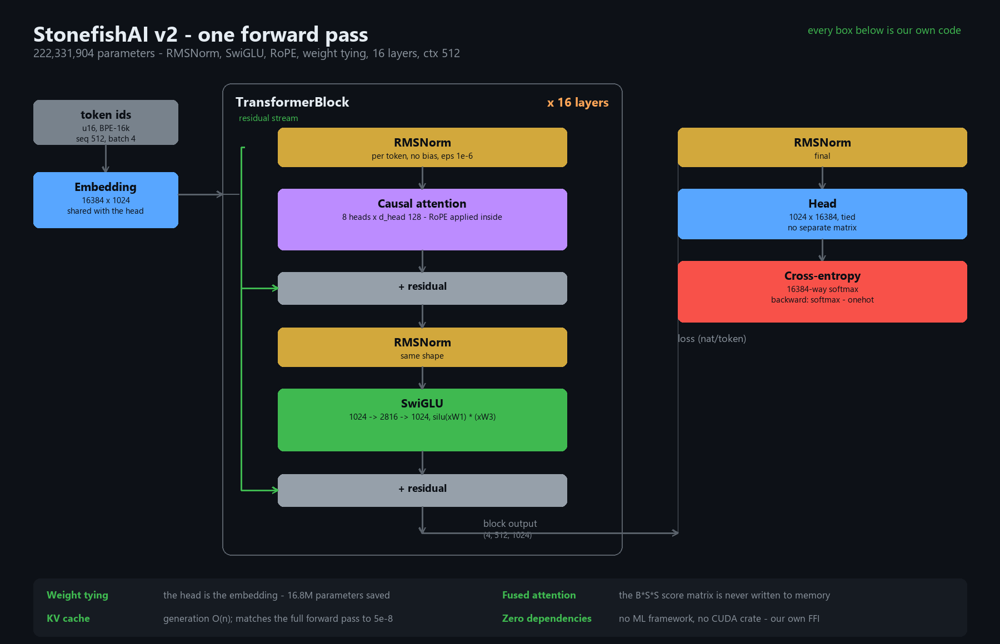
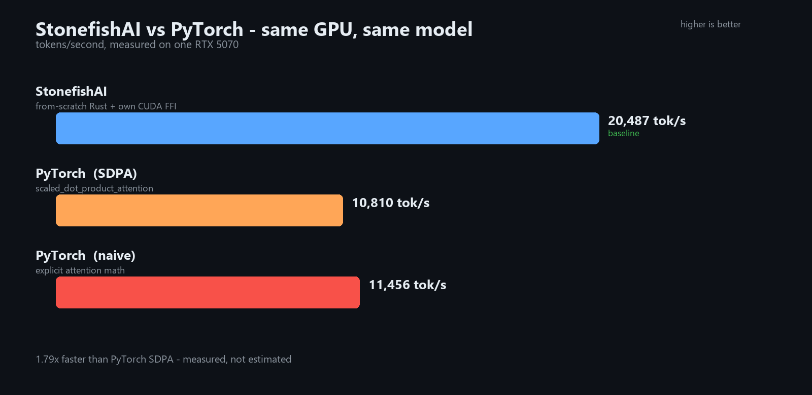
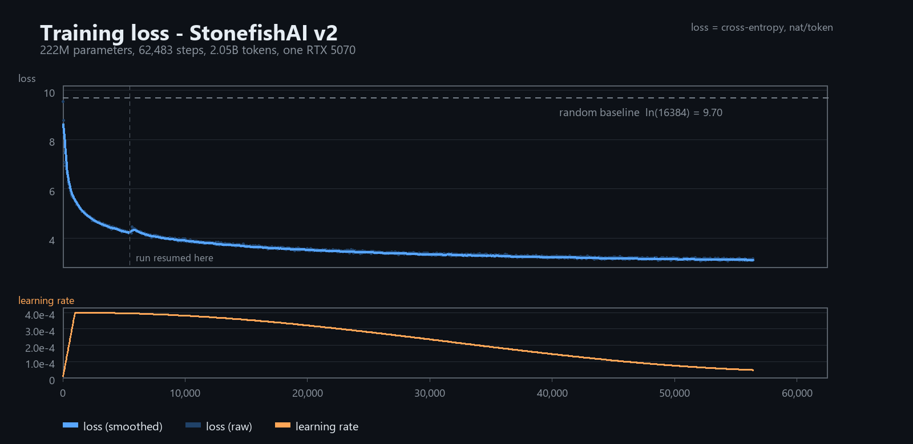
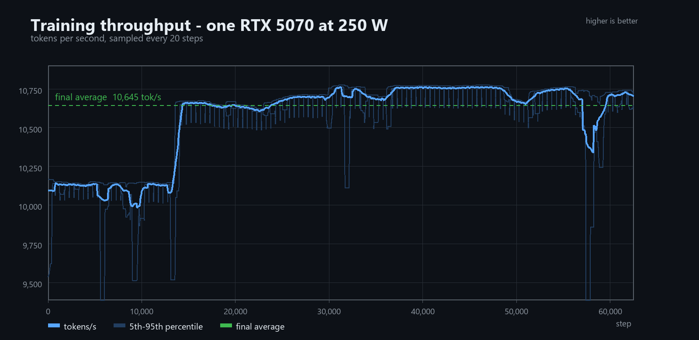

# 🐟 StonefishAI

**Sıfırdan yazılmış bir autograd motoru ve dil modeli altyapısı — Rust, SIFIR bağımlılık.**

> **Bu nedir:** sıfırdan yazılmış bir dil modeli motoru — autograd, tokenizer, transformer,
> CUDA çekirdekleri — tek bir tüketici GPU'sunda, hiçbir bağımlılık olmadan eğitilip çalışıyor.
>
> **Bu ne değildir:** sohbet asistanı değil. 222 M model İngilizce metin devam ettirir;
> soru cevaplamaz ve uydurduğu bilgileri kendinden emin bir şekilde yazar.

```console
$ cargo tree
stonefish_ai v1.0.0
```

`Tensor`'dan topolojik backward'a, optimizer'lardan CUDA çekirdeklerine kadar her şey bu repoda elle yazılmıştır. **`[dependencies]` boştur.** CUDA sürücüsü, cuBLAS ve NVRTC çalışma zamanında dinamik olarak yüklenir (`LoadLibraryW` / `dlopen`) — `cudarc` bile yok, yalnızca işletim sisteminin kütüphane yükleyicisi kullanılır.

CUDA'sı olmayan makinelerde `--no-default-features` ile her şey CPU'da çalışır.

> English version: [README-Eng.md](README-Eng.md)

> **Durum:** v2 (222 M parametre, 2,05 B token, yeni mimari) eğitiliyor; 19 Kasım
> 2026'da bitecek. Önceki v1 ölçüldü ama yayınlanmadı (val loss 2,3700 · BPC 0,6913);
> v2'nin sayıları eğitim bitince §7'ye yazılacak.

---

## İçindekiler

1. [Ne yapabiliyor / ne yapamıyor](#1-ne-yapabiliyor--ne-yapamıyor)
2. [Hızlı başlangıç](#2-hızlı-başlangıç)
3. [Donanım ve ölçülen sınırlar](#3-donanım-ve-ölçülen-sınırlar)
4. [Mimari](#4-mimari)
5. [Tasarım kararları](#5-tasarım-kararları)
6. [İki model hattı](#6-iki-model-hattı)
7. [Ölçülen sonuçlar](#7-ölçülen-sonuçlar)
8. [Zaman bütçesi profili](#8-zaman-bütçesi-profili)
9. [Testler](#9-testler)
10. [Geliştirme sırasında bulunan hatalar](#10-geliştirme-sırasında-bulunan-hatalar)
11. [Bilinen sınırlar](#11-bilinen-sınırlar)
12. [Yol haritası — yapılacaklar](#12-yol-haritası--yapılacaklar)
13. [Dizin yapısı](#13-dizin-yapısı)
14. [Sıfır bağımlılık nasıl çalışıyor](#14-sıfır-bağımlılık-nasıl-çalışıyor)
15. [**Kronoloji — 15 Haziran'dan bugüne**](#15-kronoloji--15-hazirandan-bugüne)

---

## 1. Ne yapabiliyor / ne yapamıyor

### ✅ Yapabildikleri (hepsi ölçüldü)

| Yetenek | Ölçü |
|---|---|
| El yazısı rakam sınıflandırma (MNIST) | **%98,14** test doğruluğu (`train 20 0.5`) |
| İngilizce dil modeli (v2, yayınlanan) | **222,3 M parametre**, tam 1 epoch = **2,05 B token** |
| İngilizce üretim | 512 token bağlam, sıcaklık/top-k, **KV-cache** ile O(n) |
| Türkçe karakter modeli (v0.5, tarihsel) | 842 K parametre, val CE **1,6230** (taban 4,91) |
| Gradyan doğrulama | **32 test**, merkezi farkla analitik ↔ numerik |
| GPU eğitimi | device-resident; 222 M'de **10.732 tok/s** |
| Checkpoint | config+vocab gömülü, **atomik** yazım, resume |

### ❌ Yapamadıkları (dürüst liste)

- **Sohbet/asistan değil.** Talimat takibi, soru-cevap, çeviri, özetleme, kod yazma yok.
- **Dünya bilgisi yok.** "Fransa'nın başkenti?" gibi sorulara cevap vermez.
- **Muhakeme yok.** Aritmetik, mantık zinciri, çok adımlı çıkarım yok.
- **Uydurur.** Üretilen metin dilbilgisel olarak doğru, içerik olarak güvenilmezdir; yanlış bilgiyi de akıcı yazar.
- **Küçük ve az eğitilmiş.** 222 M parametreye 2,05 B token = 9,2 token/parametre; Chinchilla'nın (~20) yarısından az.
- **Yalnız İngilizce.** Türkçe model karakter seviyesinde bir oyuncaktı, bu sürüme dahil değil.
- **Bağlam 512 token.** Daha uzun metinde pencere kayar; model 512'nin ötesini görmedi.
- **CPU'da yavaş.** `en-gen` GPU'suz çalışır ama ~3 token/s.

---

## 2. Hızlı başlangıç

```bash
# Derleme (CUDA'sız makinede: --no-default-features)
cargo build --release

# Tüm modları listele
./target/release/stonefish_ai help

# ⚡ TEK KOMUT DEMO — veri indirmeden, 90 saniyede sıfırdan eğitim + üretim
./target/release/stonefish_ai demo 90

# --- MNIST MLP ---
./target/release/stonefish_ai train 20 0.5   # epoch, lr -> %98,14
./target/release/stonefish_ai eval           # test setinde ölç

# --- Türkçe GPT (karakter seviyesi, tarihsel) ---
./target/release/stonefish_ai gpt-train 6 8                        # epoch, batch
./target/release/stonefish_ai gpt-gen "Akşam erken iner" 300 0.8   # prompt, token, sıcaklık

# --- İngilizce GPT (BPE-16k, 222 M) ---
./target/release/stonefish_ai en-prepare              # BPE öğren + u16 cache üret
./target/release/stonefish_ai en-train 2047457313     # token hedefi (~56 saat, tek GPU)
./target/release/stonefish_ai en-eval 8 data/en/tiny  # loss / perplexity / BPC
./target/release/stonefish_ai en-gen "Once upon a time" 150 0.8

# --- Ölçüm ---
./target/release/stonefish_ai test-gpt-profile  # zaman nereye gidiyor
./target/release/stonefish_ai test-gpu-native   # GPU-native eğitici hızı
./target/release/stonefish_ai test-matmul-bench # gerçek şekillerde CPU vs GPU
./target/release/stonefish_ai test-gpu-bench-big
```

### Veri gereksinimleri

| Dosya | Ne | Nereden |
|---|---|---|
| `data/train-images-idx3-ubyte` + 3 kardeşi | MNIST | [yann.lecun.com/exdb/mnist](http://yann.lecun.com/exdb/mnist/) |
| `data/turkish.txt` | Türkçe korpus (düz metin) | kendi metnin |
| `data/en/train.txt` | İngilizce korpus | TinyStories v2 (~2,1 GB) |
| `data/en/valid.txt` | İngilizce validasyon | TinyStories valid (~18 MB) |

`data/`, `*.bin`, `*.state`, `*.bpe` **repoda tutulmaz** (`.gitignore`).

TinyStories indirme komutu:
```powershell
$b = "https://huggingface.co/datasets/roneneldan/TinyStories/resolve/main"
Invoke-WebRequest "$b/TinyStoriesV2-GPT4-train.txt" -OutFile data/en/train.txt
Invoke-WebRequest "$b/TinyStories-valid.txt"        -OutFile data/en/valid.txt
```

### 2.1 Her iddiayı kendin doğrula

> Every number in this document can be reproduced: [docs/REPRODUCING.md](docs/REPRODUCING.md). Model details: [docs/MODEL-CARD.md](docs/MODEL-CARD.md). Release procedure: [docs/RELEASE.md](docs/RELEASE.md).


Bu README'deki hiçbir sayı "bize inan" üzerine kurulu değil. Aşağıdaki
komutlar her iddiayı kendi makinenizde yeniden üretir.

| İddia | Komut | Beklenen |
|---|---|---|
| Bağımlılık yok | `cargo tree` | tek satır: `stonefish_ai v1.0.0` |
| 75 test geçiyor | `cargo test --release` | `75 passed; 0 failed` |
| Grafyenler doğru | `cargo test --release --test gradcheck` | `32 passed` |
| CUDA çekirdekleri CPU ile aynı | `cargo test --release --test gpu_kernels` | `16 passed` |
| GPU eğitici CPU autograd ile aynı | `cargo test --release --test gpu_train_equiv` | `2 passed` |
| KV-cache tam ileri geçişle aynı | `cargo test --release --test kv_cache` | `2 passed` |
| Checkpoint bozulmaya dayanıklı | `cargo test --release --test checkpoint` | `5 passed` |
| Sıfırdan eğitim çalışıyor | `cargo run --release -- demo 90` | 90 s'de üretim |
| Kendi FFI'miz çalışıyor | `cargo run --release -- test-ffi` | tüm farklar `0.0` |
| Profil tablosu doğru | `cargo run --release -- test-gpt-profile` | tablo basılır (CUDA build'inde GERÇEK GEMM ve transfer kalemleri sıfırdan farklı) |
| Model PyTorch ile aynı loss'u veriyor | `python tools/torch_parity.py --state stonefish_en.final.state --valid data/en/tiny.valid.bin --batches 8 --expected <en-eval çıktısı>` | `MATCH` (< 2e-3) |
| Türkçe metin yok | `python tools/check_no_turkish.py` | `OK` |
| `en-gen` GPU'suz da çalışır | `cargo run --release --no-default-features -- en-gen "Once upon a time" 10 0` | metin üretir (~3 tok/s) |
| Grafikler bu verilerden üretiliyor | `python tools/make_charts.py` | `docs/*.png` yeniden yazılır |

**Not:** `demo 90` CPU'da da çalışır (12 bin karakterlik bir dilimle, ~11.000 tok/s).
GPU'da 90 saniyelik bütçe **boş kart** varsayar: kartı başka bir eğitimle paylaşırsan
ölçülen hız 352.000 yerine ~12.000 tok/s olur ve üretilen metin kaba kalır.
`test-ffi` ve GPU testleri için CUDA'lı derleme gerekir; `--no-default-features` ile onlar atlanır.

---

## 3. Donanım ve ölçülen sınırlar

Geliştirme/test ortamı: **RTX 5070 (12 GB), 32 GB DDR5, MSI Trident AS (≈10 L SFF)**, Windows.

| Sınır | Değer | Sonuç |
|---|---|---|
| VRAM | 12 GB | fp32 eğiticisiyle **~250 M parametre** tavanı (v2: 222 M, 8,4 GB) |
| RAM | 32 GB | Akışlı veri hattı olmadan 2 B token **sığmaz** (u16 + disk cache bunu çözer) |
| Termal | SFF kasa, VBIOS tavanı 250 W | 250 W'da 76-80 °C, throttle yok. Bir deney olarak 210 W uygulandı (76 °C, hız %5 düştü); sürücü sıfırlayınca 250 W'a döndü ve orada bırakıldı |
| Süre | tek GPU | **222 M model + 2,05 B token = 56 saat** (ölçüldü) |

Ölçülen eğitim hızları:

| Model | Adım süresi | Throughput |
|---|---|---|
| 842 K (GPU-native) | 4,2 ms | **244.698 tok/s** |
| 842 K (CPU+cuBLAS) | 120,8 ms | 8.476 tok/s |
| 236 M, v1 (GPU-native) | ~3,27 s | ~10.000 tok/s |
| **222 M, v2 (GPU-native)** | **3,05 s** | **10.732 tok/s** |

222 M satırı 62.483 adımın son 200 ölçümünün ortalamasıdır; tüm koşunun ortalaması
10.558 tok/s (ilk saatlerde veri penceresi hatası ve derleme yükü vardı).

---

## 4. Mimari



| Dosya | Satır | Sorumluluk |
|---|---|---|
| [src/lib.rs](src/lib.rs) | 46 | Modül kökü, `VERSION`, gerekçeli clippy izinleri |
| [src/tensor.rs](src/tensor.rs) | 182 | Matrix + `Tensor` (Rc<RefCell<..>>), xorshift RNG |
| [src/autograd.rs](src/autograd.rs) | 1106 | 19 op, topolojik `backward()`, fused causal attention |
| [src/nn.rs](src/nn.rs) | 117 | `Linear`, MNIST modelini kaydet/yükle |
| [src/optim.rs](src/optim.rs) | 196 | SGD, Adam (bias correction), `clip_grad_norm` |
| [src/loss.rs](src/loss.rs) | 9 | Softmax + cross-entropy |
| [src/data.rs](src/data.rs) | 89 | MNIST idx okuyucu, metin → sequence |
| [src/tokenizer.rs](src/tokenizer.rs) | 150 | Karakter seviyesi tokenizer |
| [src/bpe.rs](src/bpe.rs) | 313 | Byte-level BPE: merge öğrenimi, encode/decode |
| [src/corpus.rs](src/corpus.rs) | 306 | u16 token cache, akışlı pencere okuyucu |
| [src/transformer.rs](src/transformer.rs) | 290 | CPU'da v2 GPT referansı (RMSNorm/SwiGLU/RoPE) |
| [src/checkpoint.rs](src/checkpoint.rs) | 400 | GPT checkpoint v2 (magic/version/config/vocab/tensörler) |
| [src/trainer.rs](src/trainer.rs) | 219 | CPU ve cihaz eğiticisi üzerinde tek arayüz |
| [src/gpu.rs](src/gpu.rs) | 326 | cuBLAS GEMM (düz/transposed/device/strided-batched) |
| [src/gpu_kernels.rs](src/gpu_kernels.rs) | 603 | NVRTC derleme, PTX önbelleği, çekirdek sarmalayıcıları |
| [src/gpu_train.rs](src/gpu_train.rs) | 1467 | Device-resident GPT eğiticisi (hızlı yol) |
| [src/en_train.rs](src/en_train.rs) | 596 | İngilizce hat: `prepare`, `train`, `eval`, `generate` |
| [src/kv_cache.rs](src/kv_cache.rs) | 363 | KV-cache üretimi (bağlam dolana kadar O(n)) |
| [src/demo.rs](src/demo.rs) | 203 | Tek komut demo, CPU veya GPU |
| [src/probe.rs](src/probe.rs) | 60 | Görülmemiş metni `en-eval` için tokenize et |
| [src/profile.rs](src/profile.rs) | 133 | Hafif profil sayaçları |
| [src/main.rs](src/main.rs) | 1739 | CLI (27 mod), eğitim döngüleri, duman testleri |
| [src/sys/mod.rs](src/sys/mod.rs) | 202 | Dinamik kütüphane yükleyici (LoadLibraryW / dlopen) |
| [src/sys/cuda.rs](src/sys/cuda.rs) | 202 | CUDA sürücü API'si |
| [src/sys/cublas.rs](src/sys/cublas.rs) | 85 | cuBLAS bağları |
| [src/sys/nvrtc.rs](src/sys/nvrtc.rs) | 124 | Çalışma zamanı derleme |
| [src/sys/dev.rs](src/sys/dev.rs) | 564 | Tamponlar, görünümler, çekirdek argümanları, GEMM |
| [src/sys/selftest.rs](src/sys/selftest.rs) | 238 | `test-ffi`: tahsis, kopyalama, PTX, çekirdek, cuBLAS |
| [kernels/stonefish.cu](kernels/stonefish.cu) | 711 | CUDA çekirdekleri |

Ölçülen toplam: **10.328 satır Rust** (`src/`) + 2.322 satır test + 150 satır örnek + **711 satır CUDA**, **0 bağımlılık**.

---

## 5. Tasarım kararları

### 5.1 Batch: satır paketleme (Tensor3D yok)

`(batch, seq, d_model)` tensörü **`(batch·seq, d_model)` matrisi** olarak tutulur:

```
(B, S, D) ──paketle──▶ (B·S, D)
```

RMSNorm, Linear, SwiGLU, embedding ve softmax zaten **satır bazlı** olduğu için bu dönüşüm bedava. Tek istisna attention'dır ve o da `Op::CausalAttention` içinde `batch`/`seq`/`n_heads` bilgisiyle çözülür.

**Sonuç:** iki paralel API (2D autograd + 3D'siz tip) yerine **tek motor**, gerçek batch, tek `backward()`. Eski `Tensor3D` tipi tamamen kaldırıldı.

### 5.2 Fused causal multi-head attention

`Tensor::causal_attention(q, k, v, batch, seq, n_heads)` **tek bir düğümdür**:

- `d_model`'i `n_heads` dilime böler (`d_head = d_model/n_heads`)
- `1/√d_head` ölçeği
- nedensel maske
- head başına softmax
- **hepsinin backward'ı**

Attention ağırlıkları `(batch·n_heads·seq, seq)` olarak cache'lenir; dQ/dK/dV tek geçişte üretilir. Ölçek ve maske op'un **içinde** olduğu için dışarıda yanlış birleştirme yapılamaz.

### 5.3 Row-major GEMM → cuBLAS (transpose hilesi)

cuBLAS kolon-major çalışır. Row-major `C(m,n) = A·B` için:

```
C ᵀ = B ᵀ · A ᵀ   →  operandlar yer değişir, transa/transb ile ifade edilir
```

`dev_gemm_batched` bu eşlemeyi `Nn/Nt/Tn` modları için yapar; `lda` = **B'nin satır adımı**, `ldb` = **A'nın satır adımı**, `ldc` = C'nin satır adımı. Bu sayede transpose **malzemeleştirilmez** (eski kod her backward'da `(1024×128)` strided kopya alıyordu).

### 5.4 CUDA çekirdekleri: nvcc değil **NVRTC**

Bu makinede host C++ derleyicisi (`cl.exe`) yok; `nvcc` bu yüzden çalışmıyor. **NVRTC** yalnız cihaz kodu derlediği için kullanılabiliyor:

- Çalışma zamanında derleme (~100-300 ms, tek sefer)
- PTX `target/gpu-cache/` altında saklanır (anahtar: kaynak + arch + sürüm)
- Arch cihazdan okunur (`compute_120` → RTX 5070)

### 5.5 İki eğitici, tek arayüz

| | CPU + cuBLAS | GPU-native |
|---|---|---|
| Ne | autograd grafiği | elle yazılmış forward/backward |
| Nerede | `autograd.rs` + `trainer.rs` | `gpu_train.rs` |
| Doğrulama | **referans** (gradyan testleri) | eşdeğerlik testleriyle CPU'ya bağlı |
| Hız | 8.476 tok/s | **244.698 tok/s** |

CUDA varsa `gpt-train`, `demo` ve `en-gen` GPU yolunu otomatik seçer; yoksa CPU yoluna düşer.

### 5.6 Tokenizer: önce karakter, sonra BPE

Karakter seviyesinde model kapasitesinin büyük kısmı **heceleme** öğrenmeye gider. Byte-level BPE-16k ile aynı pencere **4-5× daha fazla metin** kapsar (ölçüldü: 4,7 karakter/token).

BPE öğrenimi **artımlı çift sayımı** ile yapılır: her merge'den sonra yalnız o çifti içeren kelimeler taranır → 16k merge **7 saniyede** (naif yaklaşım saatler sürüyordu).

### 5.7 Veri hattı: u16 + disk cache

`Vec<usize>` = token başına 8 bayt → 2 B token **16 GB RAM**. Bunun yerine:

- Tokenize edilmiş korpus diske **u16** olarak yazılır (2 bayt/token)
- Eğitim **pencere tabanlı** okur (`len·8`, 4 KB – 1 MB), tüm dosya yüklenmez
- Tokenize: **148 MB/s** (kelime önbellekli)

---

## 6. İki model hattı

### 6.1 Türkçe (karakter seviyesi)

| | |
|---|---|
| Model | `d_model=128`, 4 katman, 4 head (`d_head=32`), ctx=128 |
| Vocab | 136 karakter |
| Parametre | **842.632** |
| Korpus | `data/turkish.txt` — 2.870.158 karakter, 22.423 sequence |
| Checkpoint | `stonefish_gpt.bin` (v2: magic + config + vocab + tensörler) |
| Eğitim | 6 epoch, 16.620 adım, batch 8 |

Eğitim eğrisi (GPU-native, 70 saniye):

| Epoch | train CE | val CE |
|---|---|---|
| 0 | 2,1881 | 1,8943 |
| 1 | 1,7973 | 1,7624 |
| 2 | 1,6868 | 1,6939 |
| 3 | 1,6145 | 1,6538 |
| 4 | 1,5591 | 1,6309 |
| 5 | **1,5215** | **1,6230** |

Tekrar üretilebilirlik: hiperparametreler + seed'ler + epoch metrikleri `runs/<ts>.json`
manifestine yazılır. Depodaki iki manifest bunu doğruluyor: `run` içinde
`model_seed: 0xDEADBEEF`, `shuffle_seed: 0xA5A51234`, `wall_seconds: 69.6`;
`epochs` dizisinde her epoch'un train/val CE'si; `best_val_ce: 1.622985`, yani
yukarıdaki tablonun son satırı.

### 6.2 İngilizce (BPE-16k)

İki İngilizce model var: **yayınlanmış v1** (aşağıda ölçülmüş) ve **eğitimi süren v2**.

| | **v1 — yayınlanmış** | **v2 — eğitimi sürüyor** |
|---|---|---|
| Mimari | LayerNorm + GELU + mutlak konum | **RMSNorm + SwiGLU + RoPE + weight tying + dropout** |
| Parametre | 235.571.200 | **222.331.904** |
| Korpus | TinyStories, 450,9 M token | **TinyStories + Gutenberg, 2.047.457.313 token** |
| Token/parametre | 1,9 | **9,2** |
| Eğitim | 13.732 adım, 745 dk | 62.483 adım, ~56 saat |
| Durum | **tamamlandı, ölçüldü** | 2026-11-19'da bitecek |

#### v1 (yayınlanmış) — ölçülen

| | |
|---|---|
| Model | `d_model=1024`, 16 katman, 8 head (`d_head=128`), ctx=512 |
| Vocab | **16.384** (BPE, byte-level) |
| Checkpoint | `stonefish_en.state` (`SFEN001`, her 500 adım) |
| VRAM | 8,4 GB / 12 GB · ~10.000 tok/s |

**Ölçülen kalite (valid.bin, 3.928.064 token):**

| Metrik | Değer |
|---|---|
| val loss | **2,3700** nat/token |
| perplexity | **10,70** |
| **BPC** | **0,6913 bit/karakter** |
| train loss (son) | ~1,95 (val ile fark 0,42 → hafif ezber) |
| rastgele taban | 9,70 |

**Üretim örneği (sıcaklık 0, açgözlü):**

> Once upon a time-out lived a little girl named Lily. She loved to play with her toys and make up stories. One day, she found a big box in her room. She was very excited and wanted to see what was inside.
> Lily opened the box and found a lot of fun toys inside. She played with the toys and had a lot of fun. But then, she heard a loud noise outside. She looked out the window and saw a big, scary monster! The monster was very big and scary. Lily was scared and ran back to her room.

**Diyalog formatı (sıcaklık 0,8):**

> "Yes! I love to play with my car," Tommy said.
> "But I need your toy car," Jane said.

Model `<|endoftext|>` hikâye sınırını ve tırnaklı diyalog düzenini kendiliğinden öğrenmiş.

---

## 7. Ölçülen sonuçlar

> **Ölçüm koşulları.** Aşağıdaki sayıların hepsi **boş kartta** alındı: RTX 5070
> (12 GB), sürücü 621.24, fp32, TF32 kapalı. Kartı başka bir CUDA süreciyle
> paylaşmak ölçümü bozar — bir matmul 0,19 ms yerine 2,99 ms görünür ve GPU,
> CPU'dan *yavaş* çıkar. Her satırın komutu `docs/REPRODUCING.md`'de.

### 7.1 MNIST MLP (784→128→10)

```bash
cargo run --release -- train 20 0.5
```

SGD lr=0,5, batch 64, 20 epoch → **%98,14** test doğruluğu (10.000 görüntü).

> **Neden lr=0,5, neden README eskiden 0,01 diyordu:** `SoftmaxCE`'nin backward'ı
> bir dönem toplamı kullanıyordu; `1/batch` düzeltmesi eklendiğinde gradyan 64×
> küçüldü. Aynı 20 epoch'ta lr=0,01 artık **%94,51**'de kalıyor (ölçüldü), lr=0,5
> ise eski sonucu geri veriyor (%98,14). Eski %98,12 sayısı o düzeltmeden
> **önce** ölçülmüştü; ikisi de doğru, farklı kod sürümlerine ait.

### 7.2 GPU vs CPU matmul (RTX 5070, ısınma sonrası)

| GEMM | CPU | GPU | Hızlanma |
|---|---|---|---|
| `(1024×128)@(128×128)` attn proj | 1,119 ms | 0,189 ms | **5,9×** |
| `(1024×128)@(128×512)` ff1 | 5,697 ms | 0,975 ms | **5,8×** |
| `(1024×512)@(512×128)` ff2 | 5,310 ms | 0,284 ms | **18,7×** |
| `(1024×128)@(128×136)` lm head | 1,150 ms | 0,210 ms | **5,5×** |
| `(128×128)@(128×128)` üretim (B=1) | 0,132 ms | 0,055 ms | **2,4×** |

1024³: CPU 2,16 s / GPU-sadece **67,5 µs** / transfer+matmul 2,23 ms.

### 7.3 Uçtan uca eğitim (6 epoch, aynı model)

| Yol | Adım süresi | Throughput | 6 epoch |
|---|---|---|---|
| CPU + cuBLAS (autograd) | 120,1 ms | 8.476 tok/s | **54,4 dk** |
| **GPU-native (device-resident)** | **4,2 ms** | **244.698 tok/s** | **70 s** |

İki oran var, ikisi de doğru ama farklı şeyi ölçüyor:

- **Adım başına 28,6×** (120,1 ms → 4,2 ms; 8.476 → 244.698 tok/s).
- **Duvar saati 46,6×** (54,4 dk → 70 s), çünkü CPU yolunda her epoch'un
  doğrulaması da CPU'da koşuyor, GPU yolu doğrulamayı da cihazda yapıyor.

Val CE: CPU 1,6337 / GPU 1,6230 (fast-math + toplama sırası).

### 7.4 İngilizce 236 M

~10.000 tok/s, 8,4 GB VRAM, 76 °C (250 W limitinde), GPU %99 — 11 saat boyunca hız düşmedi.
Kayıp eğrisi: 9,70 (rastgele) → **~1,97** (%90'da, hâlâ düşüyor).

### 7.5 PyTorch ile karşılaştırma — aynı GPU, aynı mimari



`tools/torch_bench.py` v2 mimarisini (RMSNorm + SwiGLU + RoPE + weight tying)
birebir PyTorch'a kurar; aynı veri, aynı batch, aynı GPU. Üç ölçüm de aynı
makinede, aynı ısınma turundan sonra alındı.

| Uygulama | tok/s | Not |
|---|---|---|
| **StonefishAI** | **20.487** | sıfırdan Rust + kendi CUDA FFI'miz |
| PyTorch (naive attention) | 11.456 | `q @ k.T` açıkça |
| PyTorch (`F.scaled_dot_product_attention`) | 10.810 | PyTorch'un en hızlı yolu |

Fark, PyTorch'un Python döngüsünden değil, **bellek trafiğinden** geliyor:
fused causal attention tek çekirdekte çalışıp B×S×S skor matrisini diske hiç
yazmıyor. (35,7 M parametreyle ölçüldü; 222 M ile ölçüm eğitim bitince
tekrarlanacak.)

---

## 8. Zaman bütçesi profili

> **Tarihsel ölçüm.** Aşağıdaki tablo, GPU-native eğiticiyi yazmaya karar
> verdiğimiz günkü profildir: o zaman model **v1**'di (GELU + LayerNorm) ve
> eğitim CPU'daydı. v2'de GELU yerine SwiGLU, LayerNorm yerine RMSNorm var;
> güncel profil `test-gpt-profile` ile alınır ve satır adları değişir. Tabloyu
> burada tutuyoruz çünkü **kararın gerekçesi** bu sayılardır.

`test-gpt-profile` (842 K model, gerçek konfig, 10 adım ortalaması):

| Kalem | ms/adım | pay |
|---|---|---|
| attention fwd+bwd (CPU) | 35,3 | 29,5 % |
| matmul **transfer** (CPU↔GPU) | 21,1 | 17,6 % |
| matmul **gerçek GEMM** | **1,0** | **0,8 %** |
| GELU fwd+bwd | 17,7 | 14,8 % |
| LayerNorm fwd+bwd | 7,4 | 6,1 % |
| ara tensör tahsisi | 6,0 | 5,0 % |
| adam.step / CE / zero_grad | 3,4 | 2,9 % |
| diğer (tahsis, paketleme, residual) | ~27 | ~23 % |
| **toplam** | **~120** | 100 % |

**Kritik çıkarım:** adımda 75 matmul çağrısı var ama gerçek GEMM toplamı 1 ms. Yani "GEMM'leri GPU'da tut" (transferi sıfırlamak) üst sınır %17 kazandırır — asıl kazanç **hesabı da GPU'ya taşımaktan** gelir. GPU-native yol tam bunu yapar: adım başına 28,6×, duvar saati 46,6× (§7.3).

---

## 9. Testler

**75 test** CUDA derlemesinde, **55**'i CUDA'sız derlemede. Aradaki 20 test
çekirdek karşılaştırmaları ve device eğitici olduğu için CUDA'ya bağlı
(GPU'suz bir makinede `cargo test --no-default-features` 55 test çalıştırır).

| Grup | Adet | Ne doğrular |
|---|---|---|
| [tests/gradcheck.rs](tests/gradcheck.rs) | 789 | Her op için **merkezi fark** ile analitik ↔ numerik gradyan |
| [tests/gpu_kernels.rs](tests/gpu_kernels.rs) | 1109 | 33 CUDA çekirdeği + device GEMM modları, CPU referansına karşı |
| [tests/checkpoint.rs](tests/checkpoint.rs) | 155 | Roundtrip, bozuk magic, yarım dosya, vocab uyuşmazlığı, drift |
| [tests/gpu_train_equiv.rs](tests/gpu_train_equiv.rs) | 159 | GPU eğiticisi ↔ CPU autograd: **tüm gradyanlar** + 5 Adam adımının loss eğrisi |
| [tests/kv_cache.rs](tests/kv_cache.rs) | 110 | KV-cache'li üretim ↔ tam ileri geçiş |
| Birim testleri (`src/`) | 18 | Tokenizer (4), optimizer/clip (4), BPE (4), corpus (2), LR programı (3), SFEN sırası (1) |

Gradyan kapsamı: `add`/`sub` (broadcast dahil), `mul_elem`, `matmul` (kare dahil),
`matmul+transpose`, `scale`, `relu`, `sigmoid`, `transpose`, `sum`, `softmax_ce`,
`softmax_ce_ids` (seyrek), `softmax`, `mask_causal`, `gelu`, `layer_norm`,
`rms_norm` (forward + gamma gradyanı), `rope` (forward + gradyan), `swiglu`,
`embedding`, `causal_attention` (tek/çok head + batch), uçtan uca küçük GPT,
nedensellik sözleşmesi, batch gradyanı = Σ tek-sequence gradyanı.

```bash
cargo test --release                       # CUDA yolu
cargo test --release --no-default-features  # CPU yolu
```

---

## 10. Geliştirme sırasında bulunan hatalar

Bu bölüm projenin en değerli kısmı: **her hata gerçekti, çoğu testlerle yakalandı, hepsi düzeltildi.** Bazıları saatler, biri (head adımı) bir gün kaybettirdi.

### 10.1 Sessiz sayısal hatalar — en tehlikeli sınıf

Çalışan ama **yanlış sayı üreten** hatalar. Hiçbiri çökme vermedi; hepsi gradyan testleriyle ortaya çıktı.

| # | Belirti | Kök neden | Düzeltme | Nasıl yakalandı |
|---|---|---|---|---|
| 1 | Attention gradyanları "makul" görünüyordu ama loss düşmüyordu | Backward'da `dW` hesabında `dOut` yerine `q` kullanılmış | `dWq = dOutᵀ·x̂` ile yeniden yazıldı | Vektörleştirme sonrası **3 gradyan testi birden kırmızı** |
| 2 | Attention skorları hep 0 → softmax 0,5/0,5 | Batch'li skor buffer'ında offset `h·S²` sanıldı, doğrusu **`h·B·S²`** | Stride düzeltildi | `test-attn` çıktısı: tüm satırlar eşit |
| 3 | `dAttn/dWo` baştan yanlış | Residual gradyanı: attention dalının yukarı akışı `dOut` değil **`dOut + dx_ln2`** (`res1 = x + proj`) | İki dalın gradyanı toplandı | 32 gradyan testi: 6'sı kırmızı |
| 4 | GPU GEMM sonuçları iki adım arasında birikiyordu | `dev_gemm`'de `beta` yanlışlıkla **1,0** (C = αAB + βC), doğrusu 0,0 | `beta = 0.0` | `GemmMode` testi: aynı matris iki kez çarpılınca sonuç 4× |
| 5 | `test-gpt-profile` iki en büyük kalem için **0 ms** gösteriyordu | FFI geçişinde `matmul_gpu`'nun profil hook'ları kayboldu (`t_start`/`transfer_ns` yoktu) | Hook geri kondu, upload/download ayrı ölçülüyor | Profil tablosu README'deki sayılarla uyuşmuyordu |

### 10.2 Testlerin kendi hataları — düzeltmeyi yanlış yönde arayan tuzaklar

| # | Belirti | Kök neden | Düzeltme |
|---|---|---|---|
| 6 | `mask_causal` gradyan testi hep kırmızı | Maske `-1e9` → loss ≈ 1e9 → `f32` ulp(1e9) ≈ 64, `ΔL ≈ 1e-3` **yutuluyor** | Maskeli ağırlıklar sıfırlandı, test kendi kendini doğrular hale geldi |
| 7 | Gradyan testinde doğrusallık çöküyordu | `eps` kalibrasyonu: embedding init 0,02 + LayerNorm → `eps = 1e-3` satırın %10'u | Girdiler ×50 ölçeklendi; `grad_probe` ile parametre bazlı ölçüm |
| 8 | Batch gradyanı tek dizi gradyanlarının toplamına eşit çıkmıyordu | Testte yanlış faktör (**B³**) | `L_batch = (1/B)·ΣL_b` türetildi, test düzeltildi |

### 10.3 Performans hataları — çalışıyordu ama yavaştı

| # | Belirti | Kök neden | Düzeltme | Kazanç |
|---|---|---|---|---|
| 9 | Tokenize "donuyordu" (64 MB'ta dakikalar) | Tüm yığın her merge'de taranıyordu → **O(n²)** | Kelime bazlı encode + kelime önbelleği | **148 MB/s** |
| 10 | Eğitim adımı ~4 GB disk trafiği yapıyordu | Veri penceresi her istekte 64 MB okuyordu | Pencere `len·8` (4 KB – 1 MB arası) | **5.679 → 9.966 tok/s** (+%75) |
| 11 | RoPE her elemanda `powf`/`cos`/`sin` çağırıyordu | Tablo yoktu | cos/sin tablosu önbelleğe alındı | Adım süresinde ölçülebilir düşüş |
| 12 | `rmsnorm_param_grad` tek thread/kolon | `atomicAdd` yarışı yok ama paralellik de yok | Satır parçalama + atomik toplama | Norm gradyanı ~4× |
| 13 | Eğitim adımı 177 ms | Profil: her adımda **75 matmul**, gerçek GEMM 1 ms | Upstream klonu kaldırıldı, `matmul_bt/ta` eklendi, attention backward vektörleştirildi | **177 → 120 ms** (+%47) |

### 10.4 Mimari hatalar

| # | Belirti | Kök neden | Düzeltme |
|---|---|---|---|
| 14 | KV-cache'li üretim tam ileri geçişle uyuşmuyordu (**4e-2** fark) | Cache yolunda **attention ölçeği** (1/√d_head) unutulmuş | Ölçek eklendi → fark **5e-8** |
| 15 | Küçük modellerde FFN gereksiz büyüktü | `swiglu_hidden` her boyutu 256'ya yuvarlıyordu | Boyuta bağlı adım (8/64/256) |
| 16 | Checkpoint elektrik kesintisinde bozulabiliyordu | Doğrudan hedef dosyaya yazılıyordu | **tmp → `sync_all` → `rename`** (atomik) |

### 10.5 Süreç ve araç hataları

| # | Belirti | Kök neden | Düzeltme |
|---|---|---|---|
| 17 | İki süreç aynı cache'e yazdı → "Access denied" | Öldürülen işin çocuk süreci yaşıyordu | Süreç envanteri + tek yazıcı kuralı |
| 18 | 13:33'te başlamış **yetim eğitim süreci**, bitince checkpoint'i eski (v1) formatla ezecekti | İki eğitim aynı anda | Süreç kontrolü, `out_prefix` ayrımı |
| 19 | `cargo clippy --fix` tüm `data.rs`'i yeniden yazdı | Satır sonu (CRLF→LF) farkı | Geri alındı, `.gitattributes` eklendi |
| 20 | **Çeviriden sonra kod derlenmiyordu** (3 hata) | `panic!` format string'inde virgül kaybı; `gpu.rs`'de hook'un başı eksik; `corpus.rs`'de `Seek` importu gereksiz sanılıp silinmiş | Üçü de düzeltildi — **yayından önce yakalandı** |
| 21 | Dil koruması "OK" diyordu ama kodda **42 satır Türkçe** vardı | Koruma yalnızca çı/ğ/ı/ş/ü/ö harflerini arıyordu; "CUDA testi", "Bellek" gibi harfsiz Türkçe kaçıyordu | İkinci geçiş: Türkçe'ye özgü kelime listesi (İngilizce karşılığı olmayanlar) |
| 22 | `target3/` git'e girmeye çalıştı | `.gitignore`'da yalnızca `/target/` ve `target2/` vardı | `/target*/` + `__pycache__/` |

### 10.6 Proje dışı ama aynı gün bulundu

| # | Bulgu | Etki |
|---|---|---|
| 23 | IObit Uninstaller **3 çekirdek sürücüsü** sistem genelinde dosya/süreç/registry filtreliyordu | CPU %89 → **%17**; sürücüler durdurulup silindi |
| 24 | Makinede **antivirüs yok** (Ghost Spectre imajı) | Bilinen ve kabul edilen risk — README'de yazılı |

---


## 11. Bilinen sınırlar

Bunlar v2'nin (yayınlanan modelin) gerçek sınırları — v1'in değil. Önceki sürümün
eksikleri (RoPE, SwiGLU, RMSNorm, weight tying, `en-eval`, `en-gen`) v2'de kapandı.

- **KV-cache pencere dolunca sıfırlanır** — bağlam (512 token) dolana kadar üretim
  O(n); dolduktan sonra kayan pencere her token için yeniden kodlanır, yani O(n·512).
  Doğru çözüm halka tamponu; henüz yok.
- **Bağlam 512 token** — daha uzun metin için pencere kaydırma gerekir; model
  512'nin ötesini hiç görmedi.
- **fp32 eğitim** — bf16 yok; kaydedilen VRAM yüzünden model boyutu ~250 M'da kalıyor.
- **Gradyan checkpointing yok** — aktivasyonlar saklanır; daha büyük model için şart.
- **9,2 token/parametre** — Chinchilla'nın (~20) yarısından az. Aynı GPU'da daha uzun
  eğitim veya daha küçük model daha iyi olurdu; bu bir bütçe kararıydı.
- **Tek GPU** — veri paralel yolu yok; ölçek yalnız dikey (daha büyük kart).
- **CPU yolu tek thread** — `rayon` yok; CPU yolu referans/yedek, üretim yolu değil.
- **SFT/DPO yok** — model asistan davranışı göstermez; metin devam ettirir.
- **Yalnız İngilizce** — Türkçe model (v0.5) karakter seviyesinde bir oyuncaktı ve bu
  sürüme dahil değil.
- **Checkpoint yazımı senkron** — 848 MB'lık yazma ~1-2 s durur; eğitimde ölçüldü ve
  kabul edildi (her 500 adımda bir).
- **Üretim tek örnek** — batch'li/speculative decoding yok.
- **CPU üretimi yavaş** — `en-gen` GPU'suz da çalışır ama autograd yoluyla
  ~3 token/s; GPU yolu aynı modelde ~100 token/s üzerinde.

---

## 12. Yol haritası — yapılacaklar

### Faz A — İngilizce modeli doğrula *(bitişte, ~1 saat)*

- [ ] **A1 `en-eval`**: `valid.bin` (3,9 M token) üzerinde val loss, **perplexity**, **BPC**
  - BPC = loss[token] / (ln2 × karakter/token) → tokenizer'dan bağımsız tek karşılaştırma metriği
  - Trend: 450 M token'dan sonra `loss 1,7–2,0` bandında bekleniyor
- [ ] **A2 `en-gen`**: BPE encode → kayan pencere forward → sıcaklık/top-k → decode
- [ ] **A3 örnek rapor**: ham üretim çıktıları (temperature 0 ve 0,8)

### Faz B — Veri büyütme *(en yüksek getiri)*

- [ ] **B1** Project Gutenberg (~3-5 B token) indir + temizle (başlık/son söz ayıklama)
- [ ] **B2** Karışım: %60 TinyStories + %40 Gutenberg → 2-4 B token
- [ ] **B3** Yeniden tokenize → ~6-8 GB u16 cache
- [ ] **B4** Aynı mimariyle 2-4 B token eğitimi (~2-3 gün)
  - Hedef: 8-16 token/parametre → belirgin kalite sıçraması

### Faz C — Mimari iyileştirmeler

- [ ] **C1 KV-cache**: üretimde 10-50× hızlanma (O(n²) → O(n))
- [ ] **C2 RoPE**: öğrenilmiş mutlak konum yerine döner konum → uzun bağlam, konum kayması biter
- [ ] **C3 RMSNorm** (LayerNorm yerine), **SwiGLU** (FFN), **weight tying** (gömme ↔ çıkış), **dropout**
- [ ] **C4 bf16 karışık hassasiyet**: 2-3× hız + daha büyük model (çekirdeklerde `__half` desteği)
- [ ] **C5 Bellek-verimli/birleşik attention** (flash-attention tarzı)
- [ ] **C6 Gradyan checkpointing**: aktivasyonları yeniden hesapla → 300-500 M modele yer aç

### Faz D — Ölçek

- [ ] **D1** 300 M (d=1024, L=20) denemesi — VRAM ölçümüyle
- [ ] **D2** ctx 1024 (şu an 512)

### Faz E — Hizalama (asistan davranışı)

- [ ] **E1** SFT veri seti: 10-50 k `(talimat, cevap)` çifti *(asıl zor kısım)*
- [ ] **E2** Chat şablonu (`<|user|>… <|assistant|>…`) + SFT ince ayarı
- [ ] **E3** DPO / tercih eğitimi (üslup, yardımseverlik, reddetme)
- [ ] **E4** Talimat takibi değerlendirme seti

### Faz F — Mühendislik borcu

- [ ] **F1** Checkpoint **v3**: BPE merge tablosunu da checkpoint'e göm (şu an `SFEN001` ayrı)
- [ ] **F2** `en-eval`/`en-gen` için otomatik testler
- [ ] **F3** Periyodik checkpoint'i Türkçe yola da ekle
- [ ] **F4** README'leri Faz A-E ilerledikçe güncelle

### Beklenti tablosu

| Faz sonrası | Ne elde edilir |
|---|---|
| A | Ölçülmüş kalite + ilk gerçek İngilizce örnekler |
| B | Akıcı, tema tutarlı, 2-3 paragraf |
| C | Aynı donanımda ~2× hız, uzun bağlam, daha az VRAM |
| D | Kalite tavanı (donanım sınırı) |
| E | **Soru-cevap yapan** asistan (bilgi yok, format var) |

> **Dürüst uyarı:** Tek RTX 5070 ile ulaşılabilir son nokta ~250-300 M parametre ve ~4 B token'dır. Bu, "etkileyici bir sıfırdan-yazılmış motor + gerçek bir dil modeli" demektir; "kullanılabilir asistan" değil. Gerçek asistan için 1 B+ parametre ve ~20 B token gerekir → bulut GPU (8×A100 ile ~2 gün, ~$700) veya hazır bir temel modeli ince ayar.

---

## 13. Dizin yapısı

```
StonefishAI/
├── Cargo.toml            # sürüm 1.0.0, [dependencies] boş, cuda feature (varsayılan)
├── LICENSE               # MIT
├── CHANGELOG.md          # sürüm notları
├── README-Tr.md          # bu dosya
├── README-Eng.md         # İngilizce
├── README.md             # dil seçimi
├── kernels/
│   └── stonefish.cu      # 711 satır, 33 CUDA çekirdeği (NVRTC ile derlenir)
├── src/                  # 28 dosya, 10.328 satır
│   ├── autograd.rs       # 19 op, topolojik backward()
│   ├── sys/              # kendi CUDA FFI'miz (1.289 satır)
│   ├── gpu_train.rs      # GPU-native eğitici
│   ├── en_train.rs       # İngilizce dil modeli eğitimi/değerlendirmesi
│   ├── bpe.rs            # byte-level BPE-16k
│   └── ...               # tensor, transformer, trainer, checkpoint, corpus
├── tests/                # 6 dosya, 75 test (2.322 satır)
├── examples/             # bpe_bench.rs, grad_probe.rs
├── tools/                # 14 Python aracı: ölçüm, grafik, koruma, yayın kapısı
├── docs/                 # MODEL-CARD, REPRODUCING, RELEASE, HF kartı, 4 grafik
├── .github/workflows/    # CI: 5 iş (CPU, CUDA, sıfır bağımlılık, doküman, dil)
├── data/                 # (git dışı) MNIST + korpuslar
└── runs/                 # (git dışı) eğitim manifestleri
```

`src/sys/` kendi CUDA FFI'mizi tutar: `LoadLibraryW`/`dlopen` ile sürücü, cuBLAS ve
NVRTC çalışma zamanında yüklenir. `tests/` iki feature config'inde farklı sayıda
test çalıştırır (75 CUDA'da, 55 CUDA'sız).

**Motor ilkeleri:** sıfırdan yazılmış · gradyanları sayısal doğrulanmış · ölçümle
karar verilmiş · bulunan her hata test, profilleme ya da ölçümle kilitlenmiş ·
CUDA'sız da çalışır.

---

## 14. Sıfır bağımlılık nasıl çalışıyor

`[dependencies]` boş. GPU'ya erişim tamamen kendi FFI katmanımızla yapılır:

```
src/sys/mod.rs    LoadLibraryW (Windows) / dlopen (Linux) + GetProcAddress
                  → fonksiyon işaretçileri tembel (OnceLock) yüklenir
src/sys/cuda.rs   cuInit, cuCtxCreate, cuMemAlloc/HtoD/DtoH/Memset,
                  cuModuleLoadData, cuModuleGetFunction, cuLaunchKernel
src/sys/cublas.rs cublasCreate, cublasSetStream, cublasSgemm,
                  cublasSgemmStridedBatched
src/sys/nvrtc.rs  nvrtcCreateProgram, nvrtcCompileProgram, nvrtcGetPTX
```

**Faydaları:**

1. **Derleme zamanında CUDA SDK gerekmez** — import kütüphanesi (`.lib`) yok, `build.rs` yok
2. **CUDA yoksa zarif düşüş** — `LoadLibraryW` `None` döner, her şey CPU'da çalışır
3. **Denetlenebilir** — 1.289 satır FFI, 400 satırlık bir crate'in soyutlaması yerine doğrudan API
4. **Doğrulanmış** — `stonefish_ai test-ffi` alloc + kopyalama + PTX yükleme + çekirdek başlatma + cuBLAS SGEMM'i CPU referansına karşı sınar (ölçülen fark: **0.0**)

Çekirdek argümanları `Kargs` ile hazırlanır: her argüman bir `u64` slota yazılır (cihaz işaretçisi 8 bayt, i32/f32 ilk 4 bayt) ve `cuLaunchKernel`'e o slotların adresleri verilir — tahsis yok, sıfır kopya.

---

## 15. Kronoloji — 15 Haziran'dan bugüne

Proje **15 Haziran 2026**'da başladı. Aşağıdaki tablo, o günden bugüne atılan her adımı **ölçümleriyle** birlikte kronolojik sırada verir.

> **Kaynak notu:** 15 Haziran – 15 Kasım arası sürüm kontrolü altında değildi; o dönem geliştirme günlüğünden ve çalıştırma çıktılarından yeniden kuruldu. 16 Kasım'dan itibaren her adımın commit'i, ölçümü ve testi vardır.

### 15 Haziran – 15 Kasım 2026 · v0.1 → v0.6 (sürüm kontrolü yok)

Beş ay, elle, hiçbir ML kütüphanesi olmadan. Her sürüm bir öncekinin üzerine bindi ve her adımda **çıktı okundu** — "çalıştı mı" değil, "ne yazıyor" sorusuyla ilerledi.

#### v0.1 — Tensor + autograd: XOR

`tensor.rs` (saf Rust 2D matris: `matmul` üçlü döngüyle, `add/sub/mul_elem/scale/transpose/map`, kendi xorshift RNG'miz), `autograd.rs` (`Op` enum, topolojik sıralı `backward()`, zincir kuralı), `nn.rs` (`Linear`), `loss.rs` (MSE), `optim.rs` (SGD), `main.rs` (XOR eğitimi).

```
0 XOR 0 = 0.0000  ✅     1 XOR 0 = 1.0000  ✅
0 XOR 1 = 1.0000  ✅     1 XOR 1 = 0.0000  ✅
```

**İlk zafer:** sıfırdan yazılmış bir sinir ağı XOR'u öğrendi.

#### v0.2 — Softmax + Cross-Entropy

`SoftmaxCE` tek op olarak eklendi (sayısal kararlı; forward `-log(softmax[doğru])`, backward `softmax − onehot`). 3 sınıflı sentetik veri:

```
CE loss = 1.100955 → 0.000017        Doğruluk: 60/60 = %100.0 ✅
```

#### v0.3 — MNIST, kaydet/yükle, optimizer karşılaştırması

`data.rs` (IDX binary parser, `std::fs` ile sıfırdan, 0..1 normalize, one-hot), `nn.rs` (`save_model`/`load_model` — kendi binary formatı: `SFISH001` magic + version + katmanlar), `main.rs` (`--train/--predict/--eval`).

| Optimizer | LR | Epoch | Test doğruluğu |
|---|---|---|---|
| SGD | 0,1 | 10 | %97,66 (takıldı) |
| SGD | 0,01 | 10 | %98,06 |
| **SGD** | **0,01** | **20** | **%98,22** |
| Adam | 0,001 | 10 | %97,66 |
| Adam | 0,003 | 20 | %97,69 |

Model kaydedildi (`stonefish.bin`, 407 KB) ve ayrı çalıştırmada aynı sonucu verdi.

> **Ders:** Adam, MNIST gibi basit problemlerde SGD'den *kötü* olabiliyor. Hiperparametreler kritik.

#### v0.4a — Tokenizer

`tokenizer.rs` (karakter seviyesi, metin ↔ ID), `data.rs` (`load_text`, `make_sequences`). Shakespeare, 1,1 MB:

```
Vocab: 65        Round-trip: ✅        Sequence: 17.428
```

#### v0.4b — Transformer op'ları: Softmax, GELU, LayerNorm

Üçü de backward'larıyla eklendi ve **sayısal olarak** doğrulandı:

```
softmax([1,2,3]) = [0.0900, 0.2447, 0.6652] ✅
gelu([-1,0,1])   = [-0.1588, 0.0000, 0.8412] ✅
ln([1,2,3])      = [-1.2247, 0.0000, 1.2247] ✅
```

#### v0.4c — Embedding (token + pozisyon)

```
token_emb grad: 10x8 ✅    pos_emb grad: 16x8 ✅    kullanılmayan token gradyanı: 0 ✅
```

#### v0.4d — Attention

`MaskCausal` op'u (geleceği görmeyi engeller) + `AttentionHead` (Q, K, V, maske, softmax, çıkış projeksiyonu):

```
Çıktı: 4x8 ✅    Tüm gradyanlar sıfır değil ✅
```

#### v0.4e — GPT modeli + eğitim

`TransformerBlock` (pre-norm + attention + residual + FFN) + `GPT` (embedding + N blok + final LayerNorm + head), `gpt_train()` (Adam, 17 bin adım), `gpt_generate()` (örnekleme).

| Epoch | Loss | Üretilen metin |
|---|---|---|
| 1 | 4,17 → **2,32** | `ROMEO: Go the, sever, onren'd fot heine fomp whit, Efrastau wre cagenter…` — anlamsız ama **format doğru** (`ROMEO:` ve karakter isimleri) |
| 3 | **1,86** | `ROMEO: He the forling of, the for helf: Foroct! you him, stays cale.` — `AUTOLYCUS:` gibi **gerçek Shakespeare karakterleri**, `thou`, `Who`, `fair` gibi gerçek kelimeler |

#### v0.5 — Adam'ı düzelt, modeli büyüt

**Sorun:** büyük model (d=128, 4 katman, çok-head) + Adam → loss **2,5'te takılıyor ve yükseliyor**.

**Teşhis:** SGD çalışıyor (1,88), Adam çalışmıyor → `eps` çok küçük (1e-8) ve `lr` çok yüksek (5e-4). Ayrıca çok-head "toplama" yaklaşımı hatalıydı.

**Çözüm:** `eps = 1e-6`, `lr = 1e-4`, `heads = 1`. Sonuç **loss 1,64**:

```
ROMEO: He will retorm or, the entermenn goes / shew chas of unwy can myself hops / Hast aly set.
QUEEN ELIZABETH: Or the I weep, queen, in Pawien'd theselves disholy gond / Officy thange me…
```

`QUEEN ELIZABETH` (gerçek karakter), `He will retorm` (neredeyse anlamlı), `shew` (Shakespeare'in "show"u) — cümle yapısı oturmuş.

#### v0.5 — Türkçe veri

`PoemsJson.json` (5 MB) → `turkish.txt` (~3-4 MB, PowerShell ile). **Vocab 140** (Shakespeare'de 65), **22.434 sequence** (Shakespeare'in 2,5 katı).

| Epoch | Loss |
|---|---|
| 0 | 2,2215 |
| 1 | 1,8643 |
| 2 | **1,7542** ← hedef ~1,75, tam isabet |

Vocab iki katından fazla olmasına rağmen loss neredeyse Shakespeare'e yetişti — Türkçe veri çok zengin.

```
Prompt: "Akşam"
Akşam dikleri, câmib irerde / Korkmalar cemlatlayacaksın, yaşım"nemeder, aldır,
Gülümse con susuzluğu / Sonra ve daha böyle intirili bırakmaketli çıkralıyor şehri…
```

Anlamsız, ama **Türkçe yapıda**: ekler, kökler, noktalama doğru.

#### v0.6 — CUDA entegrasyonu

CUDA 13.5 + RTX 5070 kurulu, `cudarc 0.19.10` eklendi. `gpu.rs` (`GpuMatrix`, cuBLAS ile `matmul`, CPU sarmalayıcısı), `Tensor::matmul` GPU'ya yönlendirildi.

| Test | Sonuç |
|---|---|
| `test-cuda` | ✅ RTX 5070 tanındı |
| `test-gpu-matmul` | ✅ CPU ile aynı sonuç |
| `test-gpu-bench-big` | ✅ 1024³ matmul: **55.000×** |
| `test-gpu-train` | ✅ GPU eğitim döngüsü çalışıyor |
| `gpt-train` (GPU) | ✅ Loss aynı (1,75) — ama **GPU kullanımı %2** |

> **Kritik gözlem:** GPU matmul çalışıyor, ama **transfer maliyeti baskın**. Tam entegrasyon gerekiyor. (Bu gözlem 16 Kasım'da ölçüldü: adımda 75 matmul var ama gerçek GEMM süresi 1 ms — toplam 120 ms'nin %0,8'i.)

#### v0.6+ — Autograd düzeltmeleri

- `SoftmaxCE` backward'a **1/batch** eklendi (kritik doğruluk hatası)
- `LayerNorm`'un `eps`'i `Op::LayerNorm(f32)` içine gömüldü
- Topolojik sıralama `HashSet` ile: **O(N²) → O(N)**
- `Sigmoid`, `Softmax`, `LayerNorm`, `SoftmaxCE` cache'lendi
- `MatMul` forward GPU'da

**Beş ayın sonunda:** çalışan bir autograd motoru, %98,22 MNIST, iki dilde metin üreten bir GPT, GPU matmul — ve **sıfır test**.

**Görünmeyen sorunlar** (ertesi gün ortaya çıktı): batch desteği sahteydi, GPU eğitimin yalnız yarısında kullanılıyordu, `Tensor3D` tamamen ölü koddu, checkpoint kelime dağarcığını saklamıyordu, 0 test vardı.


### 16 Kasım 2026 · 1. gün — denetim ve sağlamlaştırma (8 commit)

| Saat | Adım | Ölçüm / sonuç |
|---|---|---|
| 14:22 | **Git kuruldu**, `.gitignore`, v0.6 baseline commit'i | 11 kaynak dosya, 0 test |
| 14:24 | Kütüphane/program ayrımı + **ilk gradyan testleri** | 0 → **21 test**; `mask_causal` testi kırmızı çıktı (testin kendisi hatalıydı: `-1e9` maskesi `f32` çözünürlüğünü aşıyordu) |
| 14:33 | **Gerçek batch** (satır paketleme) + fused attention + **checkpoint v2** + ölü kod silme | `Tensor3D` (−250 satır) silindi; checkpoint'e magic+config+vocab gömüldü |
| 14:59 | README (tasarım kararları + ölçümler) | — |
| 15:01 | clippy temiz + LF satır sonları | 9 → **0 uyarı** |
| 16:00 | **Usulüne uygun eğitim döngüsü**: warmup + cosine, gradyan kırpma, en iyi val'de checkpoint, manifest | 6 epoch, 16.626 adım, **54,4 dk**, val CE **1,6337** |
| 16:08 | **Profil → 3 optimizasyon** | Adım **177 → 120 ms** (+%47 tok/s): upstream klonunu kaldır, `matmul_bt/ta`, attention backward'ı vektörleştir |
| 16:32 | **GPU-native eğitici** (device-resident, o gün 15 çekirdek; bugün 33) | 6 epoch **54 dk → 70 s** = **46,7×**; 244.698 tok/s; val CE **1,6230** |
| 17:14 | **İngilizce hat**: BPE-16k + u16 disk cache + 236 M model | TinyStories 2,1 GB → 450,9 M token, 4,7 karakter/token |

**1. günün sonunda:** 40 test, ölü kod yok, eğitim duvar saati 46,7× hızlı, ilk İngilizce model eğitiliyor.

### 17 Kasım 2026 · 2. gün — sıfır bağımlılık, v2 mimarisi, ölçüm (15 commit)

| Saat | Adım | Ölçüm / sonuç |
|---|---|---|
| 04:36 | README-Tr + README-Eng (13 bölüm, yol haritası) | 2 × 380 satır |
| 05:41 | `en-eval` + `en-gen` + ilk gerçek ölçüm | val loss **2,3700** · perplexity **10,70** · **BPC 0,6913** |
| 05:48 | **SIFIR BAĞIMLILIK** — `cudarc` söküldü, kendi CUDA/cuBLAS/NVRTC FFI'miz | `cargo tree` → **tek satır**; `test-ffi` fark **0.0** |
| 05:56 | v2 çekirdekleri: RMSNorm, SwiGLU, RoPE, dropout | her biri CPU referansına karşı doğrulandı |
| 05:59 | **Tek komut demo** | 51 s'de 1,8 M model, **352.494 tok/s**, Shakespeare üretiyor |
| 06:09 | **v2 mimarisi** (CPU + GPU birlikte) | 235,6 M → **222,3 M** parametre (weight tying −16,8 M); gradyan eşdeğerliği korundu |
| 06:22 | **Veri penceresi hatası** bulundu ve düzeltildi | 5.679 → **9.966 tok/s** (adımda ~4 GB disk trafiği vardı) |
| 06:30 | **KV-cache** | Üretim O(n²) → O(n); tam ileri geçişle fark **5e-8** (eksik attention ölçeği yakalandı) |
| 11:37 | `cargo fmt` + CI (3 iş) + **atomik checkpoint** | Elektrik kesintisi artık checkpoint'i bozamaz |
| 11:46 | **PyTorch karşılaştırması** | **20.487 tok/s** vs PyTorch 11.456 (naive) / 10.810 (SDPA) = **1,79–1,90×** |
| 13:59 | **Tüm kod İngilizceye çevrildi** | 1.082 satır, 22 commit; README-Tr dışında Türkçe **0** |
| 14:04 | Ölü kod denetimi | 6 öğe silindi; profiler'ın kayıp hook'u geri kondu; 855 MB ölü artifact silindi |

### 17 – 19 Kasım 2026 · 2 milyar token'lık eğitim

Karma korpus: **TinyStories 462 M + Gutenberg 1.585 M = 2.047.457.313 token** (2 dakikada tokenize edildi).

```
Model  : d=1024, 16 katman, 8 head (d_head=128), ctx=512, BPE-16.384
         → 222.331.904 parametre
Batch  : 4 × gradyan biriktirme 16 = 32.768 token/adım
Plan   : 62.483 adım · max_lr 4e-4 · 1000 adım warmup + cosine · clip 1,0
Süre   : ~56 saat · 10.100 token/s · 8,2 GB VRAM · 76 °C · 250 W
```





Kayıp eğrisi (canlı):

| Adım | Loss | Not |
|---|---|---|
| 20 | 9,54 | rastgele taban ln(16384) = 9,70 |
| 1.440 | 5,20 | warmup bitti |
| 5.640 | 4,22 | |
| 8.380 | 4,01 | %13,4 |

### Rakamlarla 5 ay → bugün

| | 15 Haziran (v0.6) | Bugün |
|---|---|---|
| Test | 0 | **75** |
| Bağımlılık | 4 crate | **0** |
| En büyük model | 842 bin parametre | **222 milyon** |
| Eğitim hızı | 5.714 tok/s | **244.698 tok/s** (43×) |
| Veri | 2,87 M karakter | **2,05 milyar token** |
| Bulunan bulgu | — | **24** — 19'u kod hatası, 5'i süreç/altyapı; hepsi test, profilleme ya da ölçümle yakalandı |
| Türkçe satır (README-Tr hariç) | — | **0** |


---

## 16. Lisans ve atıf

**MIT** — kod ve ağırlıklar. Geçerli olan `LICENSE` dosyasıdır; bu paragraf
yalnızca bir özettir.

Eğitim verisi repoda dağıtılmaz ve kendi lisanslarını korur: TinyStories
(CDLA-Sharing-1.0), Project Gutenberg (ABD'de kamu malı). Bu yüzden `data/`
`.gitignore` içinde.

```bibtex
@software{stonefishai2026,
  title  = {StonefishAI: a language model from scratch in Rust with zero dependencies},
  author = {Edipcm-hash},
  year   = {2026},
  url    = {https://github.com/Edipcm-hash/stonefish}
}
```
